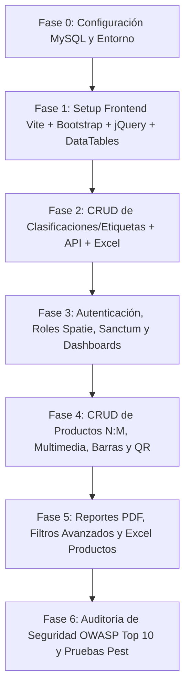

# Sistema de Gestión de Productos y sus clasificaciones

Proyecto desarrollado con **Laravel 13**, **MySQL**, **Bootstrap 5**, **jQuery**, **DataTables** y estándares de seguridad **OWASP**.

---

## 🏗️ Arquitectura y Tecnologías Principales

- **Backend:** Laravel 13 (PHP 8.3+)
- **Base de Datos:** MySQL (Motor InnoDB, Charset `utf8mb4`, Collation `utf8mb4_unicode_ci`)
- **Frontend / UI:** Bootstrap 5, jQuery, DataTables (con extensiones Responsive y Buttons)
- **Compilador de Assets:** Vite
- **Seguridad y Permisos:** Laravel Sanctum (APIs) + Spatie Laravel-Permission (Roles y Permisos RBAC)
- **Autenticación UI:** vistas Blade propias con Bootstrap 5
- **Exportaciones y Reportes:** Laravel Excel (`maatwebsite/excel`) y DOMPDF (`barryvdh/laravel-dompdf`)
- **Testing:** Pest PHP

---

## 🗄️ Modelo de Datos y Convenciones

1. **Auditoría de tiempos:**
   - Todas las tablas del sistema incluyen campos de fecha y hora:
     - `created_at` (Fecha y hora de registro)
     - `updated_at` (Fecha y hora de última actualización)
2. **Relación Muchos a Muchos (N:M):**
   - Un producto puede poseer múltiples **etiquetas de clasificación**.
   - Una etiqueta de clasificación puede estar presente en múltiples **productos**.
   - Tabla pivote intermedia: `classification_product` con claves foráneas, índices y timestamps.
3. **Formularios (UX y validación):**
   - Las etiquetas de los campos obligatorios llevan un asterisco rojo (`<span class="text-danger">*</span>`), con una leyenda "* Campo obligatorio" al inicio del formulario.
   - Validación en el cliente con atributos HTML5 y estilos de Bootstrap (`needs-validation`, `novalidate`, `was-validated`); el servidor siempre revalida con Form Requests y muestra los errores en rojo (`is-invalid`) con los datos previos (`old()`).
---

## 🗺️ Plan de Acción Paso a Paso



---

### Fase 0: Configuración de Base de Datos MySQL
- [x] Establece las variables de conexión a la base de datos en `.env`:
  ```dotenv
  DB_CONNECTION=mysql
  DB_HOST=127.0.0.1
  DB_PORT=3306
  DB_DATABASE=proy03armandobs
  DB_USERNAME=root
  DB_PASSWORD=
  ```
- [x] Configura la localización y zona horaria en `.env` y `.env.example` (`config/app.php` lee `APP_TIMEZONE`):
  ```dotenv
  APP_LOCALE=es
  APP_FAKER_LOCALE=es_MX
  APP_TIMEZONE=America/Mexico_City
  ```
- [x] Se verifica el soporte de `utf8mb4_unicode_ci` y motores InnoDB en `config/database.php`.
- [x] Se prueba la conexión y migración inicial del framework.
- [x] Idiomas: Se incluyen mensajes del framework en español en `lang/es/` (`auth`, `pagination`, `passwords`, `validation`) y `lang/es.json`; el inglés viene incluido en Laravel y es el idioma de respaldo (`APP_FALLBACK_LOCALE=en`). Los textos de las vistas se escriben solo en español. Prueba: `tests/Feature/LocalizationTest.php`.

---

### Fase 1: Arquitectura Frontend Base (Bootstrap 5 + jQuery + DataTables)
- [x] Se instalaron dependencias vía npm:
  ```bash
  npm install bootstrap @popperjs/core jquery datatables.net-bs5 datatables.net-buttons-bs5 jszip pdfmake
  ```
- [x] Se configuraron los archivos `resources/js/app.js` y `resources/css/app.css` para importar Bootstrap y exponer `window.$` y `window.jQuery`.
- [x] Se configuró `vite.config.js` y se compilaron los assets iniciales con `npm run build`.
- [x] Se diseñó el layout maestro Blade (`resources/views/layouts/app.blade.php`) con navbar responsiva, contenedor de alertas y secciones `@yield('content')` y `@push('scripts')`.
- [x] Se actualizó la página de bienvenida (`welcome.blade.php`) con Bootstrap 5.
- [x] Script global de validación del cliente en `resources/js/app.js` (formularios con clase `needs-validation`).
- [x] Se generó un componente Blade reutilizable para etiquetas con asterisco de campo obligatorio (`<x-form.label for="name" required>Nombre</x-form.label>`), con prueba en `tests/Feature/Views/FormLabelTest.php`.
- [x] Se aplicó el asterisco y la validación del cliente a los formularios existentes: clasificaciones, importación, login y registro.
- [x] Se cuenta con componentes Blade reutilizables: `<x-form.input>` (etiqueta, campo, error y valor previo) y `<x-auth.card>` (tarjeta centrada de los formularios de acceso).

---

### Fase 2: CRUD de Clasificaciones / Etiquetas (Web, API y Exportación a Excel)
- [x] **Migración y Modelo:**
  - Tabla `classifications` (`id`, `name` único, `slug` indexado, `description`, `color_badge`, `is_active`, `created_at`, `updated_at`).
  - Modelo `App\Models\Classification` con casts, fillables y factory (`ClassificationFactory`).
- [x] **Seeder:**
  - `ClassificationSeeder` con registros manuales y algunos tomados de un catálogo con Faker (usa `SaveClassification`), registrado en `DatabaseSeeder`.
- [x] **Validación:**
  - Form Request único para web, apis y excel `App\Http\Requests\ClassificationRequest` (web, API e importación Excel mediante `baseRules()`; soporta `PUT` y `PATCH` parcial).
- [x] **Acción compartida:**
  - `App\Actions\SaveClassification` (genera el `slug` y guarda); la usan el controlador web, el controlador API y la importación.
- [x] **Exportación a Excel (Instalación):**
  - Se instaló `maatwebsite/excel`.
- [x] **Exportación a Excel (Implementación):**
  - `App\Exports\ClassificationsExport` con encabezados, formato de fechas y estilos de celdas.
  - Endpoint de descarga web: `GET /classifications/export/excel`.
- [x] **Importación desde Excel:**
  - `App\Imports\ClassificationsImport` (`ToModel`, `WithHeadingRow`, `WithValidation`) que reutiliza `ClassificationRequest::baseRules()`, guarda con `SaveClassification`, acepta `is_active` vacío y rechaza nombres duplicados (en BD y dentro del archivo).
  - Endpoint web: `POST /classifications/import` (`.xlsx`/`.csv`, máx. 2 MB), con reporte de errores por fila.
- [x] **Controlador Dual:**
  - Web Controller (`ClassificationController`) con vistas Blade (`resources/views/classifications/`); el listado usa filtros y paginación en servidor (sin DataTables). Requiere sesión iniciada desde la Fase 3.
  - API Controller (`Api\ClassificationController`) con `ClassificationResource` y rutas `apiResource` (`/api/classifications`, nombres `api.classifications.*`). Requiere token de Sanctum desde la Fase 3.
- [x] **Pruebas Automatizadas (Pest):**
  - `tests/Feature/ClassificationControllerTest.php` (CRUD web, exportación e importación), `tests/Feature/Api/ClassificationControllerTest.php` (200, 201, 204, 404, 422, `PUT` y `PATCH`), `ClassificationFilterTest.php` en `tests/Feature/` y `tests/Feature/Api/` (filtros y paginación) y `tests/Feature/ErrorHandlingTest.php`.
- [x] **Cierre del módulo:** manejo centralizado de errores en `bootstrap/app.php` (`QueryException`: 409 por duplicado, 503 por falla de base de datos) y páginas de error personalizadas autónomas (`403`, `404`, `419`, `500`, `503`) en `resources/views/errors/`; la `503` se recarga sola cada 30 segundos (`<meta http-equiv="refresh">`) para recuperarse cuando la base de datos vuelve.
- [x] **Listado con filtros y paginación:**
  - Web y API comparten `ClassificationIndexRequest` (validación de `search`, `is_active` y `per_page`) y el scope `Classification::filter()`.
  - Web: formulario GET con búsqueda por nombre o slug, estado (activas/inactivas) y registros por página (5, 10, 25, 50), con paginación de Laravel (Bootstrap 5) que conserva los filtros.
  - API: parámetros `?search=`, `?is_active=` y `?per_page=` (máx. 100, por defecto 15).

---

### Fase 3: Seguridad, Autenticación y Control de Accesos (RBAC)
- [x] **Autenticación, parte A (vistas Blade propias en Bootstrap 5):**
  - Inicio de sesión (`/login`) con "recordarme" y bloqueo tras 5 intentos fallidos (`Auth\LoginRequest`), registro (`/register`, `Auth\RegisterRequest`) y cierre de sesión (`POST /logout`).
  - Rutas web de clasificaciones protegidas con el middleware `auth`; navbar según la sesión (`@auth` / `@guest`).
  - Destino único tras iniciar sesión o registrarse: la ruta `home` (o la página que el usuario había solicitado); ningún archivo de autenticación nombra un módulo.
  - Todas las respuestas web (públicas y protegidas) se envían con `Cache-Control: no-store` (middleware en el grupo `web`, `bootstrap/app.php`), porque el menú muestra el nombre y el correo del usuario; así no se ven con el botón "atrás" tras cerrar la sesión. Como red de seguridad, `resources/js/app.js` recarga una página con sesión que el navegador restaure desde memoria (`data-authenticated` en el `<body>`). La API no lleva esta cabecera. Pruebas: `tests/Feature/CacheHeadersTest.php`.
  - Reglas de nombre, correo y contraseña centralizadas en el trait `Http\Requests\Concerns\UserValidationRules`.
  - Pruebas: `tests/Feature/Auth/LoginTest.php` y `tests/Feature/Auth/RegisterTest.php`.
- [x] **Autenticación, parte B:**
  - Recuperación de contraseña (`/forgot-password` y `/reset-password/{token}`) con el broker de contraseñas de Laravel; la respuesta no revela si el correo está registrado. En local el correo se escribe en `storage/logs/laravel.log` (`MAIL_MAILER=log`) y su texto sale en español (`lang/es.json`).
  - Perfil de usuario (`/profile`): edición de nombre y correo (`ProfileRequest`), y cambio de contraseña con verificación de la contraseña actual (`PasswordUpdateRequest`); ambos reutilizan `UserValidationRules`.
  - Pruebas: `tests/Feature/Auth/PasswordResetTest.php` y `tests/Feature/ProfileTest.php`.
- [x] **Roles y Permisos con Spatie:**
  - `spatie/laravel-permission` instalado; migración de sus tablas y `config/permission.php` publicados; el modelo `User` usa `HasRoles`.
  - Roles (`App\RoleName`): `admin` y `cliente`. El "invitado" es el visitante sin cuenta, no un rol: no se puede asignar a una cuenta y una cuenta sin rol simplemente no tiene permisos. Permisos (`App\PermissionName`): `classifications.view`, `.create`, `.update`, `.delete`. Qué permisos tiene cada rol se define en `RoleName::permissions()`.
  - `RolesAndPermissionsSeeder` crea roles y permisos y elimina los roles que ya no están en `RoleName` (quien los tuviera queda sin rol, es decir, sin permisos); se puede ejecutar varias veces; `DatabaseSeeder` da el rol `admin` a `test@example.com`. Quien se registra recibe el rol `cliente`.
  - La autorización se declara en las rutas con `App\Http\ResourceAuthorization`, tabla única para web y API: `apply()` protege cada acción de un recurso con el permiso `{recurso}.{habilidad}` y `needs()` protege una ruta suelta (exportar, importar). Controladores y Form Requests no repiten la comprobación. Las instrucciones de uso están en el PHPDoc de la clase; `php artisan route:list --path=classifications -v` muestra el permiso de cada ruta.
  - Las vistas muestran cada acción solo a quien tiene el permiso: `@can(App\PermissionName::CreateClassifications->value)`. Sin permiso, la ruta responde `403`.
  - Las reglas que dependan del registro (por ejemplo, "solo sus propios pedidos") se escribirán en una policy del recurso y se sumarán en la ruta con `->can()`.
  - Pruebas: `ClassificationAuthorizationTest.php` en `tests/Feature/` y `tests/Feature/Api/`; la función `userWithRole()` de `tests/Pest.php` crea usuarios con rol.
- [ ] **Dashboards por Rol** (la gestión de usuarios del administrador ya existe en `/users`):
  - `/admin/dashboard`: Gestión de usuarios, métricas de inventario y catálogos.
  - `/cliente/dashboard`: Catálogo de productos, carrito/pedidos y perfil.
  - `/invitado/catalogo`: Vista pública de productos para el visitante sin cuenta (sin rol ni permisos de edición).
- [x] **Autenticación de la API con Laravel Sanctum (tokens):**
  - Sanctum ya estaba instalado (`php artisan install:api`: `routes/api.php` y migración `personal_access_tokens`); el modelo `User` usa `HasApiTokens`.
  - `POST /api/login` devuelve un token Bearer y los datos del usuario (`UserResource`); reutiliza `Auth\LoginRequest`, con el mismo bloqueo tras 5 intentos fallidos que la web. `POST /api/logout` revoca solo el token usado. `GET /api/user` devuelve el usuario del token.
  - Los endpoints de clasificaciones exigen `auth:sanctum`; sin token responden `401` en JSON.
  - Pruebas: `tests/Feature/Api/TokenControllerTest.php`; las pruebas de clasificaciones de la API se autentican con `Sanctum::actingAs`.
- [x] **Autorización de la API por rol:**
  - La API de clasificaciones usa la misma tabla `ResourceAuthorization` que la web; sin permiso responde `403` en JSON. `GET /api/user` incluye los roles del usuario.
- [x] **Endurecimiento de la API:**
  - Los tokens caducan a los `SANCTUM_TOKEN_EXPIRATION` minutos (480 por defecto, `config/sanctum.php`); el login devuelve `expires_in` en segundos y un token caducado responde `401`. `sanctum:prune-expired` se ejecuta a diario para borrar los caducados (requiere el programador de tareas: `php artisan schedule:work` en local).
  - Límite de 60 peticiones por minuto, por usuario o por IP si no hay token (`API_REQUESTS_PER_MINUTE` en `.env`, leído en `config/rate_limits.php`; activado con `throttleApi()` en `bootstrap/app.php`); al superarlo responde `429` con la cabecera `Retry-After`.
  - Pruebas: casos de caducidad y de límite en `tests/Feature/Api/TokenControllerTest.php`.
- [x] **Límite de intentos por IP en las rutas de acceso (web y API):**
  - Inicio de sesión: 10 por minuto; registro: 5; solicitar y restablecer contraseña: 5 entre ambas. Los valores se configuran en `.env` (`LOGIN_ATTEMPTS_PER_MINUTE`, `REGISTER_ATTEMPTS_PER_MINUTE`, `PASSWORD_ATTEMPTS_PER_MINUTE`), se leen en `config/rate_limits.php` y se aplican en las rutas con `throttle:login`, `throttle:register` y `throttle:password`.
  - Se suma al bloqueo por correo + IP del login (5 fallos): este límite frena además a quien prueba correos distintos desde una misma IP.
  - Al superarlo: página `429` propia en la web (`resources/views/errors/429.blade.php`) y `429` en JSON en la API.
  - Pruebas: `tests/Feature/Auth/RateLimitTest.php`.
- [x] **Cifrado de contraseñas con Argon2id:**
  - `HASH_DRIVER=argon2id` (por defecto en `config/hashing.php`); parámetros `ARGON_MEMORY`, `ARGON_TIME` y `ARGON_THREADS` en `.env`.
  - `HASH_VERIFY=false` deja entrar a quien aún tiene una contraseña bcrypt y la convierte a Argon2id en su siguiente inicio de sesión web (`rehash_on_login`). Quien solo usa la API conserva bcrypt hasta que inicie sesión en la web o cambie su contraseña.
  - En pruebas se usan parámetros ligeros (`phpunit.xml`). Pruebas: `tests/Feature/Auth/HashingTest.php`.
- [x] **Campo de contraseña reutilizable `<x-form.password>`:**
  - Botón para mostrar u ocultar, accesible (`aria-pressed`), y valor nunca escrito en el HTML. Pide al navegador y a los gestores de contraseñas que no rellenen el campo (`autocomplete="new-password"` y atributos `data-*`); es una petición, no una garantía. Vacía el campo al volver con "atrás".
  - Usado en inicio de sesión, registro, restablecer contraseña y cambio de contraseña del perfil. Pruebas: `tests/Feature/Views/PasswordInputTest.php`.
  - El formulario de cambio de contraseña incluye un campo de usuario oculto con el correo de la cuenta, para que el gestor de contraseñas del navegador sepa qué cuenta actualizar y no muestre la lista de cuentas guardadas.
- [x] **Confirmación de contraseña con límite de intentos (`App\Actions\ConfirmPassword`):**
  - Al cambiar la contraseña, la contraseña actual se verifica con un máximo de 3 intentos por usuario (`PASSWORD_CONFIRMATION_MAX_ATTEMPTS`, `config/auth.php`). Cada fallo indica cuántos intentos quedan; al tercero se cierra la sesión, se registra en el log (usuario e IP, nunca la contraseña) y se redirige al login con un aviso.
  - El contador se reinicia al acertar, al iniciar sesión de nuevo o a los 900 segundos (`PASSWORD_CONFIRMATION_DECAY_SECONDS`). Con el contador agotado se cierra la sesión incluso con la contraseña correcta. Un fallo no cuenta si el resto del formulario es inválido.
  - La acción es reutilizable para las acciones sensibles de la gestión de usuarios (etapa 2); la rama API (revocar el token) se añadirá con esos endpoints. Pruebas: `tests/Feature/PasswordConfirmationTest.php`.
- [x] **Gestión de usuarios, etapa 1 (web y API, solo administradores):**
  - Web (`/users`) y API (`/api/users`): listado con filtros por texto, rol y estado y paginación, alta, edición de nombre, correo y rol, desactivar, reactivar y reenviar invitación. No hay eliminación: las cuentas se desactivan. Nueva migración con `users.is_active` y `users.avatar_path` (el avatar llega en la etapa 3).
  - Permisos nuevos `users.view`, `users.create`, `users.update` y `users.deactivate` (`App\PermissionName`); solo `admin` los recibe. Las rutas los exigen con `ResourceAuthorization` (`apply()` ahora acepta una lista de habilidades) y las reglas por registro van en `App\Policies\UserPolicy` con `->can()`.
  - **Alta por invitación:** el administrador no escribe contraseña; la cuenta se crea con una aleatoria y se envía `WelcomeNotification` con el enlace para que la persona defina la suya (mismo enlace y caducidad que "restablecer contraseña"). El correo explica qué hacer, cuándo caduca el enlace (un solo uso) y que nadie del equipo pedirá la contraseña; el enlace abre una pantalla de bienvenida "Define tu contraseña" (`?invitation=1`, solo cambia los textos y no consulta la cuenta). Si el enlace venció o ya se usó, el mensaje indica pedir uno nuevo.
  - **Invitación pendiente / aceptada:** `users.invited_at` guarda cuándo se envió la última invitación e `users.invitation_accepted_at` cuándo la persona definió su contraseña (con el enlace de bienvenida o con «¿Olvidaste tu contraseña?»). El listado muestra "Invitación pendiente" y la API `invitation_pending`. "Reenviar invitación" (límite `INVITATION_ATTEMPTS_PER_MINUTE`) solo está disponible mientras la invitación sigue pendiente; genera un enlace nuevo e invalida el anterior. Las cuentas que se registraron solas nunca tienen invitación.
  - **Al desactivar:** la persona no puede iniciar sesión (web ni API, con el mismo mensaje que una contraseña incorrecta), no recibe enlaces de recuperación, se revocan sus tokens, se invalida "recordarme" y se borran sus sesiones guardadas. `EnsureUserIsActive` cierra además cualquier sesión o token que siga vivo.
  - **Protecciones:** nadie se desactiva ni cambia su propio rol; no se puede desactivar ni degradar a la última persona administradora activa; `name`, `email` y `role` son lo único que se acepta (`is_active`, `avatar_path` y la contraseña no se asignan en masa); el rol se aplica con `syncRoles`. Cada alta, cambio, desactivación, reactivación e invitación queda en el log con el id de quien la hizo.
  - Acciones: `SaveUser`, `InviteUser` y `ChangeUserStatus` (compartidas por web y API). Pruebas: `tests/Feature/UserManagementTest.php` y `tests/Feature/Api/UserManagementTest.php`.
- [x] **Gestión de usuarios, etapa 3: foto de perfil con iniciales:**
  - Componente `<x-avatar :user :size>`: muestra la foto o, si no hay, un círculo con las **dos iniciales** (de las dos primeras palabras del nombre; si es una sola, sus dos primeras letras; `User::initials()`) y un color estable que depende del nombre. Aparece en el menú, el perfil y el listado de usuarios.
  - **Editor en "Mi perfil"** (`<x-avatar-editor>`, `resources/js/avatar-editor.js`): avatar grande con una insignia de lápiz arriba a la derecha que abre una ventana con las opciones **Elegir una imagen** o **Tomar una foto** (cámara con `getUserMedia`; solo si el navegador la ofrece, y exige HTTPS o `localhost`). La imagen se mueve y se acerca con `cropperjs` (arrastrar, rueda y botones de zoom), con vista previa redonda, y se guarda con **Guardar foto**; también se puede **quitar la foto**. `cropperjs` se carga aparte, solo en esa página (import dinámico).
  - **Seguridad (servidor):** `AvatarRequest` acepta solo JPG, PNG o WebP (no SVG), de hasta 2 MB y entre 64 y 3000 px por lado, comprobando el contenido real. `SaveAvatar` (Intervention Image, GD) decodifica la imagen, aplica la orientación EXIF, recorta al centro en cuadrado, reduce a **256 px**, la convierte a **WebP** (se pierden los metadatos, como la ubicación) y la guarda con un nombre aleatorio de 40 caracteres generado por el servidor; borra la foto anterior solo cuando la nueva ya está guardada. Límite de `AVATAR_ATTEMPTS_PER_MINUTE` por IP. Cada persona cambia solo su foto; un administrador solo puede **quitar** la de otra (`users.update` y `UserPolicy::removeAvatar`).
  - **Almacenamiento sin `storage:link`:** las fotos van al disco privado (`storage/app/private/avatars`) y `GET /avatars/{archivo}` (`AvatarFileController`) las entrega; es una ruta pública y **sin sesión ni cookies** (se registra en `bootstrap/app.php`, fuera de los grupos `web` y `api`), solo acepta `40 caracteres + .webp` y envía `Cache-Control: public, max-age=31536000, immutable` y `X-Content-Type-Options: nosniff`. Funciona en cualquier hosting que ejecute Laravel.
  - **API:** `POST /api/user/avatar` (multipart, campo `avatar`), `DELETE /api/user/avatar` y, para administradores, `DELETE /api/users/{id}/avatar`; `UserResource` incluye `avatar_url` (`null` si no hay foto).
  - Probado también en el navegador (flujo completo, zoom, vista previa, quitar foto, archivo corrupto o GIF, y la captura de un fotograma de vídeo); la cámara real no se pudo probar en el entorno de desarrollo. Pruebas: `tests/Feature/AvatarTest.php`, `tests/Feature/Api/AvatarTest.php` y `tests/Feature/AvatarComponentTest.php`.
- [x] **Corrección del sembrado desde cero:** `RolesAndPermissionsSeeder` renueva la caché de permisos de Spatie entre crear los permisos y asignarlos; antes, `php artisan migrate:fresh --seed` fallaba en una base vacía porque `DatabaseSeeder` usa `WithoutModelEvents`. Cubierto en `tests/Feature/RolesAndPermissionsSeederTest.php`.
- [x] **Gestión de usuarios, etapa 2: confirmación de contraseña en una modal:**
  - Piden la contraseña de quien actúa: crear usuario, cambiar el **rol o el correo** de una cuenta (cambiar solo el nombre no la pide), desactivar, reactivar y reenviar la invitación. Cambiar el correo se añadió a lo previsto porque con él se recupera la cuenta.
  - Componente `<x-password-confirm-modal />` (una por página, con las instrucciones de uso en su comentario) y lógica en `resources/js/app.js`: en el listado, botones con `data-confirm-action`; en el alta y la edición, el formulario lleva `data-password-confirm="always"` o `"changed"` (la edición solo la pide si cambian `role` o `email`). Sin formularios ocultos ni `confirm()` del navegador.
  - **La verificación es del servidor**, no de la ventana modal: `UserRequest::requiresPasswordConfirmation()` y `PasswordConfirmationRequest` exigen `current_password` y `App\Actions\ConfirmPassword` la comprueba con el límite de **3 intentos** (compartido con el cambio de contraseña del perfil y con la API). Cada fallo vuelve a abrir la modal con "Te quedan N intentos"; al tercero se cierra la sesión (web) o se revoca el token usado y se responde `403` (API). Quien se salte la modal recibe el mismo error del servidor.
  - La contraseña se escribe con `<x-form.password>` (con mostrar/ocultar, sin autorrelleno) y nunca se devuelve al formulario.
  - Pruebas: `tests/Feature/PasswordConfirmationModalTest.php` y `tests/Feature/Api/PasswordConfirmationTest.php`; las de usuarios envían `current_password`.

---

### Fase 4: CRUD de Productos (Relación N:M, Multimedia y Códigos)
- [ ] **Migraciones y Modelos:**
  - Tabla `products` (`id`, `name`, `slug`, `description`, `photo_path`, `barcode`, `qr_code`, `stock`, `purchase_price`, `sale_price`, `is_active`, `created_at`, `updated_at`).
  - Tabla pivote `classification_product` (`id`, `product_id`, `classification_id`, `created_at`, `updated_at`) con claves foráneas en cascada e índices compuestos.
  - Relaciones Eloquent `belongsToMany` en `Product` y `Classification`.
- [ ] **Carga Segura de Imágenes:**
  - Validación de subida (MIME types reales: jpeg, png, webp; tamaño máx; almacenamiento seguro en `storage/app/public/products`).
- [ ] **Generación de Códigos:**
  - Generación de Código de Barras (EAN-13 o Code 128) y Código QR dinámico.
- [ ] **DataTables de Productos:**
  - Vista con listado de etiquetas tipo badges, foto en miniatura, búsqueda y paginación.

---

### Fase 5: Reportes, Filtros Avanzados y Exportaciones
- [ ] **Exportación de Productos a Excel:**
  - `ProductsExport` con desglose de etiquetas asociadas, stock, precios y fechas de auditoría.
- [ ] **Reportes en PDF:**
  - Integrar `barryvdh/laravel-dompdf`.
  - Reporte de catálogo completo en PDF y ficha técnica individual por producto con código de barras y QR.
- [ ] **DataTables Server-Side:**
  - Búsqueda y filtrado por rangos de precio, stock y etiquetas múltiples con optimización de consultas SQL (evitando problemas N+1 con `with('classifications')`).

---

### Fase 6: Auditoría de Seguridad OWASP Top 10 y Cierre
- [ ] **A01: Broken Access Control:** Policies de Laravel para cada recurso y validación estricta de propiedad de datos.
- [ ] **A02: Cryptographic Failures:** Contraseñas hasheadas con Argon2id (`config/hashing.php`; las contraseñas bcrypt anteriores se convierten solas en el siguiente inicio de sesión web), variables sensibles ocultas en `.env`.
- [ ] **A03: Injection:** Prepared statements con Eloquent, validaciones en FormRequests y escape estricto en Blade.
- [ ] **A04: Insecure Design:** Rate limiting con `throttle` en autenticación y APIs para prevenir ataques de fuerza bruta.
- [ ] **A05: Security Misconfiguration:** Cabeceras HTTP de seguridad (`X-Frame-Options`, `X-Content-Type-Options`, `CSP`, `Referrer-Policy`).
- [ ] **A06: Vulnerable Components:** Auditoría periódica con `composer audit` y `npm audit`.
- [ ] **A07: Identification Failures:** Expiración de sesiones, reglas fuertes de contraseña y protección contra fijación de sesión.
- [ ] **A08: Software and Data Integrity:** Validación estricta de archivos subidos por extensión y magic bytes.
- [ ] **A09: Security Logging:** Registro en log de intentos de acceso no autorizados (403/401) y eventos críticos.
- [ ] **Protección CSRF:** Tokens `@csrf` en formularios web y cabecera `X-XSRF-TOKEN` en peticiones AJAX.

---

## 🚀 Guía de Inicio Rápido (Entorno Local)

1. Clonar el repositorio y configurar variables:
   ```bash
   cp .env.example .env
   # Configurar credenciales de MySQL en .env
   ```
2. Instalar dependencias de PHP y generar clave:
   ```bash
   composer install
   php artisan key:generate
   ```
3. Ejecutar migraciones y seeders:
   ```bash
   php artisan migrate --seed
   ```
4. Instalar y compilar dependencias frontend:
   ```bash
   npm install
   npm run build
   ```
5. Iniciar servidores de desarrollo:
   ```bash
   composer run dev
   # o en terminales separadas:
   # php artisan serve
   # npm run dev
   ```


---

## 🔌 Uso de la API

Todas las peticiones llevan la cabecera `Accept: application/json`.

1. Obtener un token (el seeder crea `test@example.com` / `password`):
   ```bash
   curl -X POST http://localhost:8000/api/login -H "Accept: application/json" -d "email=test@example.com" -d "password=password"
   ```
   Respuesta: `{"data": {"id": 1, "name": "...", "email": "...", "roles": ["admin"]}, "token": "1|abc...", "token_type": "Bearer", "expires_in": 28800}`. `expires_in` son los segundos de vida del token; al caducar hay que volver a iniciar sesión.
2. Usar el token en cada petición:
   ```bash
   curl http://localhost:8000/api/classifications -H "Accept: application/json" -H "Authorization: Bearer 1|abc..."
   ```
3. Cerrar sesión (revoca ese token):
   ```bash
   curl -X POST http://localhost:8000/api/logout -H "Accept: application/json" -H "Authorization: Bearer 1|abc..."
   ```

| Respuesta | Significado |
|---|---|
| `401` | Falta el token, es inválido o fue revocado. |
| `403` | El token es válido, pero el rol del usuario no tiene permiso para esa acción. |
| `422` | Credenciales incorrectas, datos inválidos o demasiados intentos de acceso. En las acciones sensibles de `/api/users` también indica que falta `current_password` o es incorrecta (con los intentos que quedan). |

Las acciones sensibles de `/api/users` (crear, cambiar el rol o el correo, desactivar, reactivar e invitar) piden en el cuerpo la contraseña de quien las hace:

```bash
curl -X PATCH http://localhost:8000/api/users/5/deactivate -H "Accept: application/json" -H "Authorization: Bearer 1|abc..." -d "current_password=password"
```

Tras 3 contraseñas incorrectas seguidas el token usado se revoca y la respuesta es `403`; hay que iniciar sesión de nuevo.
| `429` | Más de 60 peticiones en un minuto, o más de 10 intentos de login por minuto desde la misma IP; la cabecera `Retry-After` indica cuántos segundos esperar. |

---

## 🛡️ Roles y permisos

| Rol | Clasificaciones |
|---|---|
| `admin` | Ver, crear, editar, eliminar, importar y exportar. |
| `cliente` | Ver y exportar. Es el rol de quien se registra. |

El visitante sin cuenta ("invitado") no es un rol: solo ve las páginas públicas. Una cuenta sin rol puede iniciar sesión y ver su perfil, pero no tiene acceso a ningún módulo. Importar requiere el permiso de crear; exportar, el de ver.

1. Crear las tablas de Spatie y los roles en una base de datos existente (no borra datos):
   ```bash
   php artisan migrate
   ```
   ```bash
   php artisan db:seed --class=RolesAndPermissionsSeeder
   ```
2. Dar un rol a un usuario que ya existía (los usuarios anteriores a este cambio no tienen ninguno):
   ```bash
   php artisan tinker --execute 'App\Models\User::where("email", "test@example.com")->firstOrFail()->assignRole("admin");'
   ```
3. Tras cambiar `RoleName::permissions()` o quitar un rol de `RoleName`, volver a ejecutar el seeder del paso 1.

Para añadir un permiso: nuevo caso en `App\PermissionName`, asignarlo en `RoleName::permissions()`, exigirlo en la ruta con `ResourceAuthorization::needs()` y ejecutar el seeder.

---

## ✉️ Correo: prueba local y envío real

La aplicación envía un solo correo: el enlace para restablecer la contraseña (`/forgot-password`).

### Prueba local (sin enviar nada)

Con `MAIL_MAILER=log` el correo no sale; se escribe en `storage/logs/laravel.log`.

1. Verificar en `.env`:
   ```dotenv
   MAIL_MAILER=log
   ```
2. Tener un usuario registrado. El seeder crea `test@example.com` con contraseña `password`:
   ```bash
   php artisan migrate:fresh --seed
   ```
3. Abrir `/forgot-password`, escribir el correo y pulsar "Enviar enlace".
4. Abrir `storage/logs/laravel.log` y buscar al final la línea con `/reset-password/`.
5. Copiar ese enlace en el navegador, escribir la contraseña nueva e iniciar sesión con ella.

Notas:
- El enlace caduca en 60 minutos y solo sirve una vez.
- Solo se genera un enlace por correo cada 60 segundos; un segundo intento inmediato no escribe nada en el log.
- La pantalla muestra el mismo aviso exista o no la cuenta, así que si no aparece nada en el log, revisar que el correo esté registrado.
- En el log el enlace puede salir partido en varias líneas (cada una termina en `=`) y con `=3D` en lugar de `=`. Al copiarlo hay que unir las líneas quitando ese `=` final y cambiar `=3D` por `=`.

### Envío real (SMTP)

1. Conseguir los datos SMTP del proveedor (servidor, puerto, usuario y contraseña).
2. Configurar `.env` (nunca `.env.example` ni el repositorio):
   ```dotenv
   MAIL_MAILER=smtp
   MAIL_SCHEME=null
   MAIL_HOST=smtp.proveedor.com
   MAIL_PORT=587
   MAIL_USERNAME=usuario
   MAIL_PASSWORD=contraseña
   MAIL_FROM_ADDRESS="no-responder@midominio.com"
   MAIL_FROM_NAME="${APP_NAME}"
   ```
   Con el puerto 465 usar `MAIL_SCHEME=smtps`.
3. Poner en `APP_URL` la dirección real del sitio y en `APP_NAME` el nombre que verá el destinatario.
4. Recargar la configuración:
   ```bash
   php artisan config:clear
   ```
5. Enviar un correo de prueba:
   ```bash
   php artisan tinker --execute 'Mail::raw("Prueba de envío", fn ($m) => $m->to("destinatario@example.com")->subject("Prueba"));'
   ```
6. Si llega, repetir el flujo de `/forgot-password` con una cuenta cuyo correo exista de verdad.

Notas:
- **Gmail:** servidor `smtp.gmail.com`, puerto `587`, usuario la cuenta completa y como contraseña una "contraseña de aplicación" (requiere verificación en dos pasos); la contraseña normal no funciona.
- El correo se envía dentro de la misma petición, así que no hace falta `php artisan queue:work`.
- Si falla, el error queda en `storage/logs/laravel.log`.
- En producción conviene un proveedor de correo transaccional y configurar SPF y DKIM en el dominio para no caer en spam.
