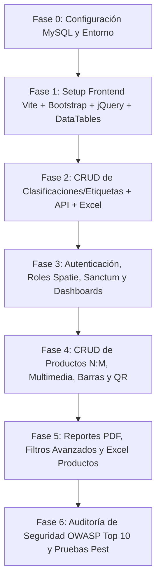

# Sistema de Gestión de Productos y Catálogo

Proyecto desarrollado con **Laravel 13**, **MySQL**, **Bootstrap 5**, **jQuery**, **DataTables** y estándares de seguridad **OWASP**.

---

## 🏗️ Arquitectura y Tecnologías Principales

- **Backend:** Laravel 13 (PHP 8.3+)
- **Base de Datos:** MySQL (Motor InnoDB, Charset `utf8mb4`, Collation `utf8mb4_unicode_ci`)
- **Frontend / UI:** Bootstrap 5, jQuery, DataTables (con extensiones Responsive y Buttons)
- **Compilador de Assets:** Vite
- **Seguridad y Permisos:** Laravel Sanctum (APIs) + Spatie Laravel-Permission (Roles y Permisos RBAC)
- **Autenticación UI:** Laravel UI / Blade Templates con Bootstrap 5
- **Exportaciones y Reportes:** Laravel Excel (`maatwebsite/excel`) y DOMPDF (`barryvdh/laravel-dompdf`)
- **Testing:** Pest PHP

---

## 🗄️ Modelo de Datos y Convenciones

1. **Auditoría Temporal Obligatoria:**
   - Todas las tablas del sistema incluyen campos de fecha y hora:
     - `created_at` (Fecha y hora de registro)
     - `updated_at` (Fecha y hora de última actualización)
2. **Relación Muchos a Muchos (N:M):**
   - Un producto puede poseer múltiples **etiquetas de clasificación**.
   - Una etiqueta de clasificación puede estar presente en múltiples **productos**.
   - Tabla pivote intermedia: `classification_product` con claves foráneas, índices y timestamps.

---

## 🗺️ Plan de Acción Paso a Paso



---

### Fase 0: Configuración de Base de Datos MySQL
- [ ] Configurar variables en `.env`:
  ```dotenv
  DB_CONNECTION=mysql
  DB_HOST=127.0.0.1
  DB_PORT=3306
  DB_DATABASE=proy03armandobs
  DB_USERNAME=root
  DB_PASSWORD=
  ```
- [x] Configurar localización y zona horaria en `.env` y `.env.example` (`config/app.php` lee `APP_TIMEZONE`):
  ```dotenv
  APP_LOCALE=es
  APP_FAKER_LOCALE=es_MX
  APP_TIMEZONE=America/Mexico_City
  ```
- [x] Verificar soporte de `utf8mb4_unicode_ci` y motores InnoDB en `config/database.php`.
- [x] Probar conexión y migración inicial del framework.

---

### Fase 1: Arquitectura Frontend Base (Bootstrap 5 + jQuery + DataTables)
- [x] Instalar dependencias vía npm:
  ```bash
  npm install bootstrap @popperjs/core jquery datatables.net-bs5 datatables.net-buttons-bs5 jszip pdfmake
  ```
- [x] Configurar `resources/js/app.js` y `resources/css/app.css` para importar Bootstrap y exponer `window.$` y `window.jQuery`.
- [x] Configurar `vite.config.js` y compilar assets iniciales con `npm run build`.
- [x] Diseñar el layout maestro Blade (`resources/views/layouts/app.blade.php`) con navbar responsiva, contenedor de alertas y secciones `@yield('content')` y `@push('scripts')`.
- [x] Actualizar página de bienvenida (`welcome.blade.php`) con Bootstrap 5.

---

### Fase 2: CRUD de Clasificaciones / Etiquetas (Web, API y Exportación a Excel)
- [x] **Migración y Modelo:**
  - Tabla `classifications` (`id`, `name` único, `slug` indexado, `description`, `color_badge`, `is_active`, `created_at`, `updated_at`).
  - Modelo `App\Models\Classification` con casts, fillables y factory (`ClassificationFactory`).
- [X] **Seeder:**
  - [x] `ClassificationSeeder` con 2 registros manuales y 5 tomados de un catálogo con Faker (usa `SaveClassification`).
  - [x] Registro en `DatabaseSeeder` con `$this->call(ClassificationSeeder::class);`.
- [x] **Validación:**
  - Form Request único `App\Http\Requests\ClassificationRequest` (web, API e importación Excel mediante `baseRules()`; soporta `PUT` y `PATCH` parcial).
- [x] **Acción compartida:**
  - `App\Actions\SaveClassification` (genera el `slug` y guarda); la usan el controlador web y la importación, y la usará la API.
- [x] **Exportación a Excel (Instalación):**
  - Instalar `maatwebsite/excel`.
- [x] **Exportación a Excel (Implementación):**
  - `App\Exports\ClassificationsExport` con encabezados, formato de fechas y estilos de celdas.
  - Endpoint de descarga web: `GET /classifications/export/excel`.
- [x] **Importación desde Excel:**
  - `App\Imports\ClassificationsImport` (`ToModel`, `WithHeadingRow`, `WithValidation`) que reutiliza `ClassificationRequest::baseRules()`, usa `SaveClassification` y rechaza nombres duplicados (en BD y dentro del archivo).
  - Endpoint web: `POST /classifications/import` (`.xlsx`/`.csv`, máx. 2 MB), con reporte de errores por fila.
- [ ] **Controlador Dual:**
  - [x] Web Controller (`ClassificationController`) con vistas Blade (`resources/views/classifications/`) y DataTables (búsqueda, paginación, orden).
  - [ ] API Controller (`Api\ClassificationController`) con `ClassificationResource` (endpoints RESTful JSON); requiere `php artisan install:api`.
- [ ] **Pruebas Automatizadas (Pest):**
  - Pruebas de integración para CRUD web, exportación/importación y respuestas API JSON (200, 201, 422).
- [ ] **Cierre del módulo:** manejo centralizado de errores en `bootstrap/app.php` (`QueryException`) y páginas de error personalizadas (`404`, `500`).

---

### Fase 3: Seguridad, Autenticación y Control de Accesos (RBAC)
- [ ] **Scaffolding de Autenticación:**
  - Instalar `laravel/ui` (`php artisan ui bootstrap --auth`) o vistas Blade personalizadas en Bootstrap 5.
  - UIs funcionales y responsivas para:
    - Inicio de sesión (`login`)
    - Registro de usuarios (`register`)
    - Recuperación de contraseña (`forgot-password` / `reset-password`)
    - Edición de perfil de usuario (`profile/edit`) y cambio de contraseña.
- [ ] **Roles y Permisos con Spatie:**
  - Instalar `spatie/laravel-permission`.
  - Definir roles: `admin`, `cliente`, `invitado`.
  - Seeders con asignación de roles y permisos específicos.
- [ ] **Dashboards por Rol:**
  - `/admin/dashboard`: Gestión de usuarios, métricas de inventario y catálogos.
  - `/cliente/dashboard`: Catálogo de productos, carrito/pedidos y perfil.
  - `/invitado/catalogo`: Vista pública de productos sin permisos de edición.
- [ ] **Seguridad de APIs con Laravel Sanctum:**
  - Endpoints de autenticación `/api/login` y `/api/logout`.
  - Proteger los endpoints de clasificaciones y productos con middleware `auth:sanctum` y políticas `can:...`.

---

### Fase 4: CRUD de Productos (Relación N:M, Multimedia y Códigos)
- [ ] **Migraciones y Modelos:**
  - Tabla `products` (`id`, `name`, `slug`, `description`, `photo_path`, `barcode`, `qr_code`, `stock`, `purchase_price`, `sale_price`, `is_active`, `created_at`, `updated_at`).
  - Tabla pivote `classification_product` (`id`, `product_id`, `classification_id`, `created_at`, `updated_at`) con claves foráneas en cascada e índices compuestos.
  - Relaciones Eloquent `belongsToMany` en `Product` y `Classification`.
- [ ] **Carga Segura de Imágenes:**
  - Validación de subida (MIME types reales: jpeg, png, webp; tamaño máx; almacenamiento seguro en `storage/app/public/products`).
- [ ] **Generación de Códigos:**
  - Generación de Código de Barras (EAN-13 o Code 128) y Código QR dinámico.
- [ ] **DataTables de Productos:**
  - Vista con listado de etiquetas tipo badges, foto en miniatura, búsqueda y paginación.

---

### Fase 5: Reportes, Filtros Avanzados y Exportaciones
- [ ] **Exportación de Productos a Excel:**
  - `ProductsExport` con desglose de etiquetas asociadas, stock, precios y fechas de auditoría.
- [ ] **Reportes en PDF:**
  - Integrar `barryvdh/laravel-dompdf`.
  - Reporte de catálogo completo en PDF y ficha técnica individual por producto con código de barras y QR.
- [ ] **DataTables Server-Side:**
  - Búsqueda y filtrado por rangos de precio, stock y etiquetas múltiples con optimización de consultas SQL (evitando problemas N+1 con `with('classifications')`).

---

### Fase 6: Auditoría de Seguridad OWASP Top 10 y Cierre
- [ ] **A01: Broken Access Control:** Policies de Laravel para cada recurso y validación estricta de propiedad de datos.
- [ ] **A02: Cryptographic Failures:** Contraseñas hasheadas (Bcrypt cost 12), variables sensibles ocultas en `.env`.
- [ ] **A03: Injection:** Prepared statements con Eloquent, validaciones en FormRequests y escape estricto en Blade.
- [ ] **A04: Insecure Design:** Rate limiting con `throttle` en autenticación y APIs para prevenir ataques de fuerza bruta.
- [ ] **A05: Security Misconfiguration:** Cabeceras HTTP de seguridad (`X-Frame-Options`, `X-Content-Type-Options`, `CSP`, `Referrer-Policy`).
- [ ] **A06: Vulnerable Components:** Auditoría periódica con `composer audit` y `npm audit`.
- [ ] **A07: Identification Failures:** Expiración de sesiones, reglas fuertes de contraseña y protección contra fijación de sesión.
- [ ] **A08: Software and Data Integrity:** Validación estricta de archivos subidos por extensión y magic bytes.
- [ ] **A09: Security Logging:** Registro en log de intentos de acceso no autorizados (403/401) y eventos críticos.
- [ ] **Protección CSRF:** Tokens `@csrf` en formularios web y cabecera `X-XSRF-TOKEN` en peticiones AJAX.

---

## 🚀 Guía de Inicio Rápido (Entorno Local)

1. Clonar el repositorio y configurar variables:
   ```bash
   cp .env.example .env
   # Configurar credenciales de MySQL en .env
   ```
2. Instalar dependencias de PHP y generar clave:
   ```bash
   composer install
   php artisan key:generate
   ```
3. Ejecutar migraciones y seeders:
   ```bash
   php artisan migrate --seed
   ```
4. Instalar y compilar dependencias frontend:
   ```bash
   npm install
   npm run build
   ```
5. Iniciar servidores de desarrollo:
   ```bash
   composer run dev
   # o en terminales separadas:
   # php artisan serve
   # npm run dev
   ```
