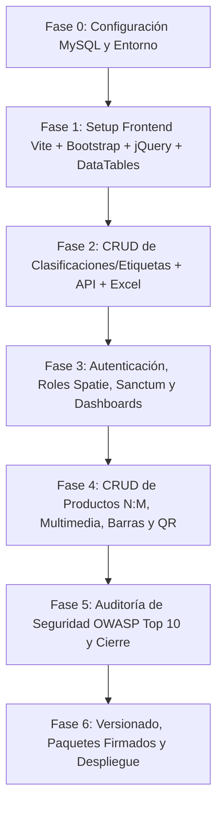

# Sistema de Gestión de Productos y sus clasificaciones

Proyecto desarrollado con **Laravel 13**, **MySQL**, **Bootstrap 5**, **jQuery**, **DataTables** y estándares de seguridad **OWASP**.

---

## 🏗️ Arquitectura y Tecnologías Principales

- **Backend:** Laravel 13 (PHP 8.3+)
- **Base de Datos:** MySQL (Motor InnoDB, Charset `utf8mb4`, Collation `utf8mb4_unicode_ci`)
- **Frontend / UI:** Bootstrap 5, jQuery, DataTables (con extensiones Responsive y Buttons)
- **Compilador de Assets:** Vite
- **Seguridad y Permisos:** Laravel Sanctum (APIs) + Spatie Laravel-Permission (Roles y Permisos RBAC)
- **Autenticación UI:** vistas Blade propias con Bootstrap 5
- **Exportaciones:** Laravel Excel (`maatwebsite/excel`) para exportar e importar clasificaciones.
- **Testing:** Pest PHP

---

## 🗄️ Modelo de Datos y Convenciones

1. **Auditoría de tiempos:**
   - Todas las tablas del sistema incluyen campos de fecha y hora:
     - `created_at` (Fecha y hora de registro)
     - `updated_at` (Fecha y hora de última actualización)
2. **Relación Muchos a Muchos (N:M):**
   - Un producto puede poseer múltiples **etiquetas de clasificación**.
   - Una etiqueta de clasificación puede estar presente en múltiples **productos**.
   - Tabla pivote intermedia: `classification_product` con claves foráneas, índices y timestamps.
3. **Formularios (UX y validación):**
   - Las etiquetas de los campos obligatorios llevan un asterisco rojo (`<span class="text-danger">*</span>`), con una leyenda "* Campo obligatorio" al inicio del formulario.
   - Validación en el cliente con atributos HTML5 y estilos de Bootstrap (`needs-validation`, `novalidate`, `was-validated`); el servidor siempre revalida con Form Requests y muestra los errores en rojo (`is-invalid`) con los datos previos (`old()`).
---

## 🗺️ Plan de Acción Paso a Paso



---

### Fase 0: Configuración de Base de Datos MySQL
- [x] Establece las variables de conexión a la base de datos en `.env`:
  ```dotenv
  DB_CONNECTION=mysql
  DB_HOST=127.0.0.1
  DB_PORT=3306
  DB_DATABASE=proy03armandobs
  DB_USERNAME=root
  DB_PASSWORD=
  ```
- [x] Configura la localización y zona horaria en `.env` y `.env.example` (`config/app.php` lee `APP_TIMEZONE`):
  ```dotenv
  APP_LOCALE=es
  APP_FAKER_LOCALE=es_MX
  APP_TIMEZONE=America/Mexico_City
  ```
- [x] Se verifica el soporte de `utf8mb4_unicode_ci` y motores InnoDB en `config/database.php`.
- [x] Se prueba la conexión y migración inicial del framework.
- [x] Idiomas: Se incluyen mensajes del framework en español en `lang/es/` (`auth`, `pagination`, `passwords`, `validation`) y `lang/es.json`; el inglés viene incluido en Laravel y es el idioma de respaldo (`APP_FALLBACK_LOCALE=en`). Los textos de las vistas se escriben solo en español. Prueba: `tests/Feature/LocalizationTest.php`.

---

### Fase 1: Arquitectura Frontend Base (Bootstrap 5 + jQuery + DataTables)
- [x] Se instalaron dependencias vía npm:
  ```bash
  npm install bootstrap @popperjs/core jquery datatables.net-bs5 datatables.net-buttons-bs5 jszip pdfmake
  ```
- [x] Se configuraron los archivos `resources/js/app.js` y `resources/css/app.css` para importar Bootstrap y exponer `window.$` y `window.jQuery`.
- [x] Se configuró `vite.config.js` y se compilaron los assets iniciales con `npm run build`.
- [x] Se diseñó el layout maestro Blade (`resources/views/layouts/app.blade.php`) con navbar responsiva, contenedor de alertas y secciones `@yield('content')` y `@push('scripts')`.
- [x] Se actualizó la página de bienvenida (`welcome.blade.php`) con Bootstrap 5.
- [x] Script global de validación del cliente en `resources/js/app.js` (formularios con clase `needs-validation`).
- [x] Se generó un componente Blade reutilizable para etiquetas con asterisco de campo obligatorio (`<x-form.label for="name" required>Nombre</x-form.label>`), con prueba en `tests/Feature/Views/FormLabelTest.php`.
- [x] Se aplicó el asterisco y la validación del cliente a los formularios existentes: clasificaciones, importación, login y registro.
- [x] Se cuenta con componentes Blade reutilizables: `<x-form.input>` (etiqueta, campo, error y valor previo) y `<x-auth.card>` (tarjeta centrada de los formularios de acceso).

---

### Fase 2: CRUD de Clasificaciones / Etiquetas (Web, API y Exportación a Excel)
- [x] **Migración y Modelo:**
  - Tabla `classifications` (`id`, `name` único, `slug` indexado, `description`, `color_badge`, `is_active`, `created_at`, `updated_at`).
  - Modelo `App\Models\Classification` con casts, fillables y factory (`ClassificationFactory`).
- [x] **Seeder:**
  - `ClassificationSeeder` con registros manuales y algunos tomados de un catálogo con Faker (usa `SaveClassification`), registrado en `DatabaseSeeder`.
- [x] **Validación:**
  - Form Request único para web, apis y excel `App\Http\Requests\ClassificationRequest` (web, API e importación Excel mediante `baseRules()`; soporta `PUT` y `PATCH` parcial).
- [x] **Acción compartida:**
  - `App\Actions\SaveClassification` (genera el `slug` y guarda); la usan el controlador web, el controlador API y la importación.
- [x] **Exportación a Excel (Instalación):**
  - Se instaló `maatwebsite/excel`.
- [x] **Exportación a Excel (Implementación):**
  - `App\Exports\ClassificationsExport` con encabezados, formato de fechas y estilos de celdas.
  - Endpoint de descarga web: `GET /classifications/export/excel`.
- [x] **Importación desde Excel:**
  - `App\Imports\ClassificationsImport` (`ToModel`, `WithHeadingRow`, `WithValidation`) que reutiliza `ClassificationRequest::baseRules()`, guarda con `SaveClassification`, acepta `is_active` vacío y rechaza nombres duplicados (en BD y dentro del archivo).
  - Endpoint web: `POST /classifications/import` (`.xlsx`/`.csv`, máx. 2 MB), con reporte de errores por fila.
- [x] **Controlador Dual:**
  - Web Controller (`ClassificationController`) con vistas Blade (`resources/views/classifications/`); el listado usa filtros y paginación en servidor (sin DataTables). Requiere sesión iniciada desde la Fase 3.
  - API Controller (`Api\ClassificationController`) con `ClassificationResource` y rutas `apiResource` (`/api/classifications`, nombres `api.classifications.*`). Requiere token de Sanctum desde la Fase 3.
- [x] **Pruebas Automatizadas (Pest):**
  - `tests/Feature/ClassificationControllerTest.php` (CRUD web, exportación e importación), `tests/Feature/Api/ClassificationControllerTest.php` (200, 201, 204, 404, 422, `PUT` y `PATCH`), `ClassificationFilterTest.php` en `tests/Feature/` y `tests/Feature/Api/` (filtros y paginación) y `tests/Feature/ErrorHandlingTest.php`.
- [x] **Cierre del módulo:** manejo centralizado de errores en `bootstrap/app.php` (`QueryException`: 409 por duplicado, 503 por falla de base de datos) y páginas de error personalizadas autónomas (`403`, `404`, `419`, `500`, `503`) en `resources/views/errors/`; la `503` se recarga sola cada 30 segundos (`<meta http-equiv="refresh">`) para recuperarse cuando la base de datos vuelve.
- [x] **Listado con filtros y paginación:**
  - Web y API comparten `ClassificationIndexRequest` (validación de `search`, `is_active` y `per_page`) y el scope `Classification::filter()`.
  - Web: formulario GET con búsqueda por nombre o slug, estado (activas/inactivas) y registros por página (5, 10, 25, 50), con paginación de Laravel (Bootstrap 5) que conserva los filtros.
  - API: parámetros `?search=`, `?is_active=` y `?per_page=` (máx. 100, por defecto 15).

---

### Fase 3: Seguridad, Autenticación y Control de Accesos (RBAC)
- [x] **Autenticación, parte A (vistas Blade propias en Bootstrap 5):**
  - Inicio de sesión (`/login`) con "recordarme" y bloqueo tras 5 intentos fallidos (`Auth\LoginRequest`), registro (`/register`, `Auth\RegisterRequest`) y cierre de sesión (`POST /logout`).
  - Rutas web de clasificaciones protegidas con el middleware `auth`; navbar según la sesión (`@auth` / `@guest`).
  - Destino único tras iniciar sesión o registrarse: la ruta `home` (o la página que el usuario había solicitado); ningún archivo de autenticación nombra un módulo.
  - Todas las respuestas web (públicas y protegidas) se envían con `Cache-Control: no-store` (middleware en el grupo `web`, `bootstrap/app.php`), porque el menú muestra el nombre y el correo del usuario; así no se ven con el botón "atrás" tras cerrar la sesión. Como red de seguridad, `resources/js/app.js` recarga una página con sesión que el navegador restaure desde memoria (`data-authenticated` en el `<body>`). La API no lleva esta cabecera. Pruebas: `tests/Feature/CacheHeadersTest.php`.
  - Reglas de nombre, correo y contraseña centralizadas en el trait `Http\Requests\Concerns\UserValidationRules`.
  - Pruebas: `tests/Feature/Auth/LoginTest.php` y `tests/Feature/Auth/RegisterTest.php`.
- [x] **Autenticación, parte B:**
  - Recuperación de contraseña (`/forgot-password` y `/reset-password/{token}`) con el broker de contraseñas de Laravel; la respuesta no revela si el correo está registrado. En local el correo se escribe en `storage/logs/laravel.log` (`MAIL_MAILER=log`) y su texto sale en español (`lang/es.json`).
  - Perfil de usuario (`/profile`): edición de nombre y correo (`ProfileRequest`), y cambio de contraseña con verificación de la contraseña actual (`PasswordUpdateRequest`); ambos reutilizan `UserValidationRules`.
  - Pruebas: `tests/Feature/Auth/PasswordResetTest.php` y `tests/Feature/ProfileTest.php`.
- [x] **Roles y Permisos con Spatie:**
  - `spatie/laravel-permission` instalado; migración de sus tablas y `config/permission.php` publicados; el modelo `User` usa `HasRoles`.
  - Roles (`App\RoleName`): `admin` y `cliente`. El "invitado" es el visitante sin cuenta, no un rol: no se puede asignar a una cuenta y una cuenta sin rol simplemente no tiene permisos. Permisos (`App\PermissionName`): `classifications.*` en esta fase y, con los módulos siguientes, `products.*`, `users.*`, `dashboard.admin`, `dashboard.client` y `security.view` (tabla completa en "Roles y permisos"). Qué permisos tiene cada rol se define en `RoleName::permissions()`.
  - `RolesAndPermissionsSeeder` crea roles y permisos y elimina los roles que ya no están en `RoleName` (quien los tuviera queda sin rol, es decir, sin permisos); se puede ejecutar varias veces; `DatabaseSeeder` da el rol `admin` a `test@example.com`. Quien se registra recibe el rol `cliente`.
  - La autorización se declara en las rutas con `App\Http\ResourceAuthorization`, tabla única para web y API: `apply()` protege cada acción de un recurso con el permiso `{recurso}.{habilidad}` y `needs()` protege una ruta suelta (exportar, importar). Controladores y Form Requests no repiten la comprobación. Las instrucciones de uso están en el PHPDoc de la clase; `php artisan route:list --path=classifications -v` muestra el permiso de cada ruta.
  - Las vistas muestran cada acción solo a quien tiene el permiso: `@can(App\PermissionName::CreateClassifications->value)`. Sin permiso, la ruta responde `403`.
  - Las reglas que dependan del registro (por ejemplo, "nadie se desactiva a sí mismo", que ya vive en `UserPolicy`) se escribirán en una policy del recurso y se sumarán en la ruta con `->can()`.
  - Pruebas: `ClassificationAuthorizationTest.php` en `tests/Feature/` y `tests/Feature/Api/`; la función `userWithRole()` de `tests/Pest.php` crea usuarios con rol.
- [x] **Dashboards por Rol y catálogo público** (se completó después de la Fase 4, porque muestran productos; la gestión de usuarios del administrador ya existe en `/users`):
  - **Acceso:** al iniciar sesión o registrarse, `User::homeRoute()` lleva a cada persona a su panel (administrador → `admin.dashboard`, cliente → `client.dashboard`, sin rol → inicio); si venía de una página protegida, vuelve a ella. El menú tiene "Catálogo" para todos y "Mi panel" para quien tiene uno. Cada panel exige su permiso (`dashboard.admin` / `dashboard.client`; hay que volver a ejecutar `php artisan db:seed --class=RolesAndPermissionsSeeder`).
  - `/admin/dashboard` (`BuildAdminDashboard`): tarjetas con productos (activos e inactivos), sin existencias, stock bajo, clasificaciones, usuarios (activos, desactivados e invitaciones pendientes) y **valor del inventario** (existencias × precio de compra, dato interno); lista "Requieren atención" (sin stock o en el mínimo, más cuántos no tienen portada ni código de barras), últimos productos, usuarios recientes y accesos rápidos de alta.
  - `/cliente/dashboard` (`BuildClientDashboard`): saludo, buscador, **novedades** (últimos productos activos), las clasificaciones con más productos activos (conteo en caché 10 minutos) y su cuenta. Sin precio de compra ni datos de gestión.
  - `/invitado/catalogo` (`CatalogController`, sin sesión, `throttle:catalog`): listado con búsqueda y filtro por clasificación, y ficha `/invitado/catalogo/{slug}` con galería. **Solo productos activos** (uno inactivo o eliminado responde 404) y sin datos internos (ni precio de compra ni existencias exactas: solo "Disponible" o "Agotado"). Es la dirección que codifica el QR de cada producto.
  - **Filtro de inactivos:** quien no puede editar productos (el cliente) ve por defecto solo los activos en el listado y en la API; el filtro "Estado" le permite cambiar a "Inactivos" o "Todos" (`ProductIndexRequest::filters()`). Quien edita productos ve todos por defecto.
  - **Paginación y tamaño de página:** cada lista de los paneles (en el del administrador, "Requieren atención", "Últimos productos" y "Usuarios recientes"; en el del cliente, "Novedades") y el catálogo público tienen un selector **"Mostrar" con 5, 10, 20 y 50** (`config/catalog.php`: `page_sizes`). Por defecto, **5** en cada lista de los paneles y **10** en el catálogo (`dashboard_page_size`, `catalog_page_size`). Cada lista pagina con su propia página y su propio tamaño (`attention_page`/`attention_per_page`, `products_page`/`products_per_page`, `users_page`/`users_per_page`; `page`/`per_page` en el cliente y en el catálogo), así que paginar o cambiar el tamaño de una no mueve las otras. Un valor fuera de esas opciones se rechaza (`DashboardRequest`, `CatalogIndexRequest`). Cambiar el tamaño devuelve la lista a su primera página; el selector solo aparece si hay más elementos que la opción menor. Los enlaces conservan los demás filtros y saltan a su sección (`#atencion`, `#ultimos-productos`, `#usuarios-recientes`, `#novedades`). Componente reutilizable: `<x-per-page-select>`. Los listados de productos, clasificaciones y usuarios conservan su propio selector (5, 10, 25, 50; 10 por defecto) y la API pagina de 15 en 15 (`per_page` hasta 100).
  - **Catálogo público, compacto:** el título y el buscador (con el selector de tamaño) van en la misma línea, el buscador a la derecha; la cuadrícula es de **5 por fila** desde pantallas grandes, con tarjetas compactas (imagen 16:10, nombre en una línea), de modo que con 10 por página se ven **dos filas completas y el paginador sin desplazarse** a 1366×768.

- [x] **Autenticación de la API con Laravel Sanctum (tokens):**
  - Sanctum ya estaba instalado (`php artisan install:api`: `routes/api.php` y migración `personal_access_tokens`); el modelo `User` usa `HasApiTokens`.
  - `POST /api/login` devuelve un token Bearer y los datos del usuario (`UserResource`); reutiliza `Auth\LoginRequest`, con el mismo bloqueo tras 5 intentos fallidos que la web. `POST /api/logout` revoca solo el token usado. `GET /api/user` devuelve el usuario del token.
  - Los endpoints de clasificaciones exigen `auth:sanctum`; sin token responden `401` en JSON.
  - Pruebas: `tests/Feature/Api/TokenControllerTest.php`; las pruebas de clasificaciones de la API se autentican con `Sanctum::actingAs`.
- [x] **Autorización de la API por rol:**
  - La API de clasificaciones usa la misma tabla `ResourceAuthorization` que la web; sin permiso responde `403` en JSON. `GET /api/user` incluye los roles del usuario.
- [x] **Endurecimiento de la API:**
  - Los tokens caducan a los `SANCTUM_TOKEN_EXPIRATION` minutos (480 por defecto, `config/sanctum.php`); el login devuelve `expires_in` en segundos y un token caducado responde `401`. `sanctum:prune-expired` se ejecuta a diario para borrar los caducados (requiere el programador de tareas: `php artisan schedule:work` en local; en el servidor, el cron de Laravel, que también ejecuta la revisión diaria de seguridad de la Fase 5).
  - Límite de 60 peticiones por minuto, por usuario o por IP si no hay token (`API_REQUESTS_PER_MINUTE` en `.env`, leído en `config/rate_limits.php`; activado con `throttleApi()` en `bootstrap/app.php`); al superarlo responde `429` con la cabecera `Retry-After`.
  - Pruebas: casos de caducidad y de límite en `tests/Feature/Api/TokenControllerTest.php`.
- [x] **Límite de intentos por IP en las rutas de acceso (web y API):**
  - Inicio de sesión: 10 por minuto; registro: 5; solicitar y restablecer contraseña: 5 entre ambas. Los valores se configuran en `.env` (`LOGIN_ATTEMPTS_PER_MINUTE`, `REGISTER_ATTEMPTS_PER_MINUTE`, `PASSWORD_ATTEMPTS_PER_MINUTE`), se leen en `config/rate_limits.php` y se aplican en las rutas con `throttle:login`, `throttle:register` y `throttle:password`.
  - Se suma al bloqueo por correo + IP del login (5 fallos): este límite frena además a quien prueba correos distintos desde una misma IP.
  - Al superarlo: página `429` propia en la web (`resources/views/errors/429.blade.php`) y `429` en JSON en la API.
  - Pruebas: `tests/Feature/Auth/RateLimitTest.php`.
- [x] **Cifrado de contraseñas con Argon2id:**
  - `HASH_DRIVER=argon2id` (por defecto en `config/hashing.php`); parámetros `ARGON_MEMORY`, `ARGON_TIME` y `ARGON_THREADS` en `.env`.
  - `HASH_VERIFY=false` deja entrar a quien aún tiene una contraseña bcrypt y la convierte a Argon2id en su siguiente inicio de sesión web (`rehash_on_login`). Quien solo usa la API conserva bcrypt hasta que inicie sesión en la web o cambie su contraseña.
  - En pruebas se usan parámetros ligeros (`phpunit.xml`). Pruebas: `tests/Feature/Auth/HashingTest.php`.
- [x] **Campo de contraseña reutilizable `<x-form.password>`:**
  - Botón para mostrar u ocultar, accesible (`aria-pressed`), y valor nunca escrito en el HTML. Pide al navegador y a los gestores de contraseñas que no rellenen el campo (`autocomplete="new-password"` y atributos `data-*`); es una petición, no una garantía. Vacía el campo al volver con "atrás".
  - Usado en inicio de sesión, registro, restablecer contraseña y cambio de contraseña del perfil. Pruebas: `tests/Feature/Views/PasswordInputTest.php`.
  - El formulario de cambio de contraseña incluye un campo de usuario oculto con el correo de la cuenta, para que el gestor de contraseñas del navegador sepa qué cuenta actualizar y no muestre la lista de cuentas guardadas.
- [x] **Confirmación de contraseña con límite de intentos (`App\Actions\ConfirmPassword`):**
  - Al cambiar la contraseña, la contraseña actual se verifica con un máximo de 3 intentos por usuario (`PASSWORD_CONFIRMATION_MAX_ATTEMPTS`, `config/auth.php`). Cada fallo indica cuántos intentos quedan; al tercero se cierra la sesión, se registra en el registro de seguridad (usuario e IP, nunca la contraseña) y se redirige al login con un aviso.
  - El contador se reinicia al acertar, al iniciar sesión de nuevo o a los 900 segundos (`PASSWORD_CONFIRMATION_DECAY_SECONDS`). Con el contador agotado se cierra la sesión incluso con la contraseña correcta. Un fallo no cuenta si el resto del formulario es inválido.
  - La misma acción protege las acciones sensibles de la gestión de usuarios (etapa 2 de esa gestión), en la web y en la API: en la API, al agotar los intentos se revoca el token y se responde `403`. Pruebas: `tests/Feature/PasswordConfirmationTest.php`.
- [x] **Gestión de usuarios, etapa 1 (web y API, solo administradores):**
  - Web (`/users`) y API (`/api/users`): listado con filtros por texto, rol y estado y paginación, alta, edición de nombre, correo y rol, desactivar, reactivar y reenviar invitación. No hay eliminación: las cuentas se desactivan. Nueva migración con `users.is_active` y `users.avatar_path` (el avatar llega en la etapa 3).
  - Permisos nuevos `users.view`, `users.create`, `users.update` y `users.deactivate` (`App\PermissionName`); solo `admin` los recibe. Las rutas los exigen con `ResourceAuthorization` (`apply()` ahora acepta una lista de habilidades) y las reglas por registro van en `App\Policies\UserPolicy` con `->can()`.
  - **Alta por invitación:** el administrador no escribe contraseña; la cuenta se crea con una aleatoria y se envía `WelcomeNotification` con el enlace para que la persona defina la suya (mismo enlace y caducidad que "restablecer contraseña"). El correo explica qué hacer, cuándo caduca el enlace (un solo uso) y que nadie del equipo pedirá la contraseña; el enlace abre una pantalla de bienvenida "Define tu contraseña" (`?invitation=1`, solo cambia los textos y no consulta la cuenta). Si el enlace venció o ya se usó, el mensaje indica pedir uno nuevo.
  - **Invitación pendiente / aceptada:** `users.invited_at` guarda cuándo se envió la última invitación e `users.invitation_accepted_at` cuándo la persona definió su contraseña (con el enlace de bienvenida o con «¿Olvidaste tu contraseña?»). El listado muestra "Invitación pendiente" y la API `invitation_pending`. "Reenviar invitación" (límite `INVITATION_ATTEMPTS_PER_MINUTE`) solo está disponible mientras la invitación sigue pendiente; genera un enlace nuevo e invalida el anterior. Las cuentas que se registraron solas nunca tienen invitación.
  - **Al desactivar:** la persona no puede iniciar sesión (web ni API, con el mismo mensaje que una contraseña incorrecta), no recibe enlaces de recuperación, se revocan sus tokens, se invalida "recordarme" y se borran sus sesiones guardadas. `EnsureUserIsActive` cierra además cualquier sesión o token que siga vivo.
  - **Protecciones:** nadie se desactiva ni cambia su propio rol; no se puede desactivar ni degradar a la última persona administradora activa; `name`, `email` y `role` son lo único que se acepta (`is_active`, `avatar_path` y la contraseña no se asignan en masa); el rol se aplica con `syncRoles`. Cada alta, cambio, desactivación, reactivación e invitación queda en el log con el id de quien la hizo.
  - Acciones: `SaveUser`, `InviteUser` y `ChangeUserStatus` (compartidas por web y API). Pruebas: `tests/Feature/UserManagementTest.php` y `tests/Feature/Api/UserManagementTest.php`.
- [x] **Gestión de usuarios, etapa 2: confirmación de contraseña en una modal:**
  - Piden la contraseña de quien actúa: crear usuario, cambiar el **rol o el correo** de una cuenta (cambiar solo el nombre no la pide), desactivar, reactivar y reenviar la invitación. Cambiar el correo se añadió a lo previsto porque con él se recupera la cuenta.
  - Componente `<x-password-confirm-modal />` (una por página, con las instrucciones de uso en su comentario) y lógica en `resources/js/app.js`: en el listado, botones con `data-confirm-action`; en el alta y la edición, el formulario lleva `data-password-confirm="always"` o `"changed"` (la edición solo la pide si cambian `role` o `email`). Sin formularios ocultos ni `confirm()` del navegador.
  - **La verificación es del servidor**, no de la ventana modal: `UserRequest::requiresPasswordConfirmation()` y `PasswordConfirmationRequest` exigen `current_password` y `App\Actions\ConfirmPassword` la comprueba con el límite de **3 intentos** (compartido con el cambio de contraseña del perfil y con la API). Cada fallo vuelve a abrir la modal con "Te quedan N intentos"; al tercero se cierra la sesión (web) o se revoca el token usado y se responde `403` (API). Quien se salte la modal recibe el mismo error del servidor.
  - La contraseña se escribe con `<x-form.password>` (con mostrar/ocultar, sin autorrelleno) y nunca se devuelve al formulario.
  - Pruebas: `tests/Feature/PasswordConfirmationModalTest.php` y `tests/Feature/Api/PasswordConfirmationTest.php`; las de usuarios envían `current_password`.
- [x] **Gestión de usuarios, etapa 3: foto de perfil con iniciales:**
  - Componente `<x-avatar :user :size>`: muestra la foto o, si no hay, un círculo con las **dos iniciales** (de las dos primeras palabras del nombre; si es una sola, sus dos primeras letras; `User::initials()`) y un color estable que depende del nombre. Aparece en el menú, el perfil y el listado de usuarios.
  - **Editor en "Mi perfil"** (`<x-avatar-editor>`, `resources/js/avatar-editor.js`): avatar grande con una insignia de lápiz arriba a la derecha que abre una ventana con las opciones **Elegir una imagen** o **Tomar una foto** (cámara con `getUserMedia`; solo si el navegador la ofrece, y exige HTTPS o `localhost`). La imagen se mueve y se acerca con `cropperjs` (arrastrar, rueda y botones de zoom), con vista previa redonda, y se guarda con **Guardar foto**; también se puede **quitar la foto**. `cropperjs` se carga aparte, solo en esa página (import dinámico).
  - **Seguridad (servidor):** `AvatarRequest` acepta solo JPG, PNG o WebP (no SVG), de hasta 2 MB y entre 64 y 3000 px por lado, comprobando el contenido real. `SaveAvatar` (Intervention Image, GD) decodifica la imagen, aplica la orientación EXIF, recorta al centro en cuadrado, reduce a **256 px**, la convierte a **WebP** (se pierden los metadatos, como la ubicación) y la guarda con un nombre aleatorio de 40 caracteres generado por el servidor; borra la foto anterior solo cuando la nueva ya está guardada. Límite de `AVATAR_ATTEMPTS_PER_MINUTE` por IP. Cada persona cambia solo su foto; un administrador solo puede **quitar** la de otra (`users.update` y `UserPolicy::removeAvatar`).
  - **Almacenamiento sin `storage:link`:** las fotos van al disco privado (`storage/app/private/avatars`) y `GET /avatars/{archivo}` (`AvatarFileController`) las entrega; es una ruta pública y **sin sesión ni cookies** (se registra en `bootstrap/app.php`, fuera de los grupos `web` y `api`), solo acepta `40 caracteres + .webp` y envía `Cache-Control: public, max-age=31536000, immutable` y `X-Content-Type-Options: nosniff`. Funciona en cualquier hosting que ejecute Laravel.
  - **API:** `POST /api/user/avatar` (multipart, campo `avatar`), `DELETE /api/user/avatar` y, para administradores, `DELETE /api/users/{id}/avatar`; `UserResource` incluye `avatar_url` (`null` si no hay foto).
  - Probado también en el navegador (flujo completo, zoom, vista previa, quitar foto, archivo corrupto o GIF, y la captura de un fotograma de vídeo); la cámara real no se pudo probar en el entorno de desarrollo. Pruebas: `tests/Feature/AvatarTest.php`, `tests/Feature/Api/AvatarTest.php` y `tests/Feature/AvatarComponentTest.php`.
- [x] **Corrección del sembrado desde cero:** `RolesAndPermissionsSeeder` renueva la caché de permisos de Spatie entre crear los permisos y asignarlos; antes, `php artisan migrate:fresh --seed` fallaba en una base vacía porque `DatabaseSeeder` usa `WithoutModelEvents`. Cubierto en `tests/Feature/RolesAndPermissionsSeederTest.php`.

---

### Fase 4: CRUD de Productos (Relación N:M, Multimedia y Códigos)
- [x] **Etapa 1: Migraciones, modelos y CRUD** (web y API):
  - Tabla `products`: `sku` único, `name`, `slug` único e inmutable (forma parte de la URL y del futuro QR), `description`, `barcode` EAN-13 único, `stock`, `min_stock`, `purchase_price` y `sale_price` (`decimal(10,2)`), `is_active`, `created_by`/`updated_by` y baja lógica (`deleted_at`). Con respecto a lo previsto originalmente: `photo_path` se sustituye por una tabla de multimedia (etapa 2) y no hay columna `qr_code`, porque el QR se genera al vuelo con la URL del producto.
  - Pivote `classification_product` con claves foráneas en cascada, índice único `(product_id, classification_id)` y relaciones `belongsToMany` en `Product` y `Classification`.
  - Permisos `products.view|create|update|delete` (el administrador los tiene todos; el cliente solo `products.view` y no ve el precio de compra). Rutas con `ResourceAuthorization::apply` (`/products`, `/api/products`), dirección por `slug`.
  - `App\Actions\SaveProduct` crea y actualiza: SKU `PRD-000123` y EAN-13 interno (prefijo `2` + id + dígito de control, `App\Actions\GenerateBarcode`) si se dejan vacíos, slug único (también frente a productos eliminados) y autoría tomada de quien actúa, nunca de la petición. La regla `App\Rules\Ean13` valida los códigos indicados a mano.
  - Listado con filtros en servidor: texto (nombre, SKU, código de barras o slug), clasificaciones (basta con tener alguna), estado, existencias (sin stock, stock bajo, suficiente) y rango de precio de venta; clasificaciones cargadas con `with()` (sin N+1). Precios formateados con `Number::currency` según `config/catalog.php` (`CATALOG_CURRENCY`, `CATALOG_CURRENCY_LOCALE`).
  - Eliminar es lógico; el SKU, el código de barras y el slug de un producto eliminado no se reutilizan.
  - Datos de ejemplo: `ProductSeeder` (10 productos, incluido en `DatabaseSeeder`). Pruebas: `ProductTest`, `Api/ProductTest`, `ProductBarcodeTest`.
  - **Selector de clasificaciones con historial** (filtro del listado y formulario de producto): como pueden ser miles, no se cargan todas. `<x-classification-picker>` (Tom Select, `resources/js/classification-picker.js`, cargado solo en las páginas que lo usan) consulta `GET /classifications/lookup` (`throttle:lookup`, permiso `classifications.view`). La lista inicial se pide al **abrir la página** (para que el primer clic no espere) y al enfocarlo vacío se muestra sin filtrar: las **Recientes** del usuario (con ✕ para quitarlas) y debajo las **Sugeridas** (las 10 primeras por nombre; no se cuentan productos para no frenar la apertura con muchos registros); con 1 o 2 letras esa lista no cambia, y con **3 letras o más** busca en el servidor (máx. 20 **Resultados**). El formulario solo ofrece clasificaciones activas.
  - Historial en la tabla `classification_users_searches` (`user_id`, `classification_id`, `last_used_at`, único por usuario y clasificación, cascada): **se anota en el momento de elegir** una clasificación en el selector (`POST /classifications/recent/{classification}`), no al filtrar ni al guardar; `RecordClassificationSearches` conserva las 10 más recientes por usuario. Las ya elegidas no se ofrecen en el desplegable, pero al quitar su etiqueta vuelven a aparecer como recientes. Relación `User::recentClassifications()`. La ✕ borra una reciente (`DELETE` a la misma ruta, `ClassificationRecentController`; solo la fila de quien lo pide). Pruebas: `ClassificationLookupTest`.
- [x] **Etapa 2: Multimedia (hasta 9 archivos por producto):**
  - Reglas en `config/catalog.php` (`media`): hasta **9** archivos entre fotos y videos; fotos JPG, PNG o WebP de hasta **2 MB** (y 40 megapíxeles); videos MP4 o WebM de **menos de 10 MB** y **máximo 5 minutos**. `App\Rules\ProductMediaFile` decide el tipo por el **contenido** del archivo (no por su extensión) y lee la duración con `james-heinrich/getid3` (`App\Actions\ProbeVideo`, sin ffmpeg).
  - Tabla `product_media` (tipo, nombre de archivo aleatorio, miniatura, nombre original, tamaño, duración, posición) y `products.cover_media_id` (portada: siempre una foto). `AddProductMedia` re-codifica cada foto a WebP (máx. 1600 px, sin metadatos) con una miniatura cuadrada de 320 px, guarda los videos tal cual, bloquea el producto para no pasar del límite y borra lo ya escrito si algo falla; la primera foto subida es la portada. `RemoveProductMedia` borra la fila y los archivos, renumera y reasigna la portada; `SetProductCover` y `ReorderProductMedia` completan las acciones.
  - Archivos en el disco privado (`storage/app/private/products`), servidos por la ruta pública `GET /media/products/{archivo}` (`ProductMediaFileController`, sin `storage:link`, caché de un año y **soporte de `Range`** para adelantar y retroceder videos).
  - Web: la ficha del producto muestra la galería (ampliar foto o reproducir video en una ventana) y, con `products.update`, subir, elegir portada, mover antes o después y eliminar. Listado: miniatura de la portada (cargada con `with('cover')`, sin N+1). API: `GET|POST /api/products/{producto}/media`, `PUT .../media/order`, `PATCH .../media/{id}/cover`, `DELETE .../media/{id}` (subir es `multipart/form-data` con `media[]`); `ProductResource` incluye `cover_url` y `media`. Límite de peticiones: clave `media` (`MEDIA_ATTEMPTS_PER_MINUTE`).
  - **Servidor:** para subir videos de casi 10 MB hay que subir `upload_max_filesize` (≥ 10M) y `post_max_size` en `php.ini` (una petición con varios videos puede sumar decenas de MB); si el hosting los limita, la subida falla con el mensaje "no se pudo subir el archivo". Pruebas: `ProductMediaTest`, `ProductMediaFileTest`, `Api/ProductMediaTest`.
- [x] **Etapa 3: Códigos** (la ficha del producto muestra una tarjeta "Códigos"):
  - **Código de barras EAN-13** como SVG (`App\Actions\RenderBarcodeSvg`, con `picqer/php-barcode-generator`): barras, zona de silencio y dígitos legibles (1 + 6 + 6). Solo acepta EAN-13 con dígito de control correcto; si el producto no tiene código (o no es válido) la ruta responde 404 y la ficha lo avisa.
  - **QR** como SVG (`App\Actions\RenderQrSvg`, con `bacon/bacon-qr-code`, corrección de errores M) que codifica la dirección de la **ficha del catálogo público** (`/invitado/catalogo/{slug}`, armada con `APP_URL`); como el slug no cambia, un QR impreso sigue funcionando, y quien lo escanee no necesita cuenta (si el producto está inactivo, la ficha responde 404).
  - Se generan al momento y no se guardan. Rutas `GET /products/{producto}/barcode.svg` y `/qr.svg` (y las equivalentes en `/api/products/...`, con token), permiso `products.view`; con `?download=1` se descargan como `{sku}-barcode.svg` o `{sku}-qr.svg`. Respuesta con `Content-Type: image/svg+xml`, `nosniff` y una política de contenido que prohíbe scripts y recursos. Pruebas: `ProductCodesTest` y `Api/ProductCodesTest`.
- [x] **Etapa 4: Cierre y revisión de seguridad del módulo de productos** (`tests/Feature/ProductSecurityTest.php`):
  - **Autorización:** las 25 rutas de productos (web y API) exigen sesión y el permiso de su acción; una prueba las recorre todas (sin sesión → 401, sin rol → 403, cliente en escritura → 403) y **falla si se agrega una ruta nueva**, para obligar a revisarla. La única ruta pública es la de archivos (`/media/products/...`), a propósito.
  - **Corregido en esta revisión:** (1) la API entregaba `purchase_price` al cliente; ahora solo lo ve quien tiene `products.update`, igual que la ficha web; (2) el QR usaba el dominio de la petición, ahora usa `APP_URL` (una etiqueta impresa desde `localhost` o con un `Host` falsificado ya no sale con esa dirección); (3) los archivos públicos llevan `Content-Security-Policy: default-src 'none'; sandbox`; (4) eliminar un producto queda en el log (`product.deleted`, con quien lo hizo y si fue definitivo); (5) al eliminar un producto definitivamente se borran sus archivos del disco (antes quedaban huérfanos).
  - **Comprobado sin cambios:** todo se muestra escapado (nombres, descripciones, etiquetas y nombres de archivo con `<script>` o comillas); la búsqueda y los filtros usan parámetros enlazados (probado con intentos de inyección SQL); no hay SQL ni HTML crudo en `app/`, `resources/` ni `routes/`; `slug`, autor y portada no se asignan desde la petición.
  - **Limitaciones conocidas:** quien tenga la URL de un archivo lo ve aunque el producto esté inactivo o eliminado (los nombres son aleatorios de 40 caracteres); el cliente ve por defecto solo los activos, pero puede pedir los inactivos con el filtro "Estado" (es una preferencia de vista, no un bloqueo; si debiera ser un bloqueo, basta quitar esa opción en `ProductIndexRequest::filters()`); **resueltas en la Fase 5:** la búsqueda ya trata `%` y `_` como texto literal y los 401/403 se registran en el canal `security` (A03 y A09).
- [x] **Cancelado:** historial de movimientos de stock (`stock_movements`), carrito de compra y pedidos. No se implementarán; el stock se edita directamente en el producto.

---

### Fase 5: Auditoría de Seguridad OWASP Top 10 y Cierre
- [x] **A01: Broken Access Control:** no hay recursos que pertenezcan a una persona (los productos y las clasificaciones son del negocio), así que el control es por **rol y permiso** (Spatie) y no por propiedad; las reglas entre personas (no cambiar el propio rol, no desactivarse, no dejar al sistema sin administrador) están en `UserPolicy`. `tests/Feature/RouteSecurityAuditTest.php` recorre **todas** las rutas de la aplicación y falla si una ruta nueva no exige sesión, no exige permiso (salvo el perfil propio), no pasa por `EnsureUserIsActive` o la API no usa Sanctum; y llama a cada ruta protegida sin sesión (login o 401). Las 14 rutas públicas están declaradas a propósito en esa prueba.
- [x] **A02: Cryptographic Failures:** contraseñas con Argon2id (`config/hashing.php`; las de bcrypt se convierten solas en el siguiente inicio de sesión web), sesión cifrada (`SESSION_ENCRYPT=true` por defecto), tokens de la API con caducidad, secretos solo en `.env` (fuera del repositorio; `.env.example` no lleva valores reales). `php artisan security:check` lo verifica.
- [x] **A03: Injection:** consultas con parámetros enlazados (Eloquent), validación en FormRequests y escape de Blade (probado con `<script>` en nombres, descripciones y archivos). **Nuevo:** las búsquedas tratan `%` y `_` como texto literal (`whereContainsText`, `escape '!'`, igual en MySQL y SQLite) en productos, clasificaciones y usuarios. Prueba: `SearchEscapingTest`.
- [x] **A04: Insecure Design:** límites de intentos separados para login, registro, recuperación de contraseña, invitaciones, fotos, multimedia, búsquedas y catálogo público (`config/rate_limits.php`), bloqueo del login tras 5 fallos y de la confirmación de contraseña tras 3.
- [x] **A05: Security Misconfiguration:** `App\Http\Middleware\SecurityHeaders` (configurable en `config/security.php`) añade a toda respuesta `X-Frame-Options: DENY`, `X-Content-Type-Options: nosniff`, `Referrer-Policy`, `Permissions-Policy` (solo la propia página usa la cámara), `Cross-Origin-Opener-Policy`, **HSTS** (solo por HTTPS) y una **CSP** sin `unsafe-inline` en scripts: los scripts en línea llevan un *nonce* distinto en cada respuesta (`Vite::cspNonce()`), no hay `onclick`/`onchange` en línea y se quita `X-Powered-By`. `SECURITY_CSP=report-only` permite probar un cambio sin bloquear nada y `off` la apaga. Revisado en el navegador con la CSP activa (panel, productos, galería con foto y video, selector de clasificaciones, editor de foto de perfil y catálogo). Prueba: `SecurityHeadersTest`. **Si agregas un script en línea, usa `<script nonce="{{ Vite::cspNonce() }}">`.**
- [x] **A06: Vulnerable Components:** `composer audit` y `npm audit` (ver "Auditoría de dependencias" abajo): tras `composer update` (20 de noviembre de 2026: `laravel/framework` 13.43, `laravel/sanctum` 4.5, `laravel/boost` 2.10.4, `pestphp/pest` 5.3.7, entre otros) **`composer audit` no reporta ningún aviso** (ni en producción ni en desarrollo), `composer outdated --direct` no tiene nada pendiente y `npm audit` está en 0 vulnerabilidades. Los avisos anteriores de `phpunit/phpunit` y `symfony/yaml` (solo de desarrollo) quedaron resueltos.
- [x] **A07: Identification Failures:** `Password::defaults()` exige **12 caracteres con letras y números** (y en producción rechaza contraseñas filtradas públicamente, consultando solo una huella parcial); la sesión caduca a los **60 minutos** de inactividad; el identificador de sesión se regenera al iniciar sesión y al registrarse (fijación de sesión); al cambiar la contraseña desde el perfil se cierran las **demás** sesiones web y se revocan los tokens de la API (al restablecerla por correo, también), con `authenticateSessions()`. Prueba: `SessionSecurityTest`.
- [x] **A08: Software and Data Integrity:** los archivos subidos se validan por **su contenido** y no por el nombre: tipo detectado con `finfo`, medidas con `getimagesize` y duración de video con getID3 (`ProductMediaFile`, `AvatarRequest`); las fotos se **recodifican** a WebP (se descarta cualquier carga oculta) y se guardan con nombres aleatorios en el disco privado, servidos con `X-Content-Type-Options: nosniff` y una CSP propia (`default-src 'none'; sandbox`). Pruebas: `ProductMediaTest`, `ProductMediaFileTest`, `AvatarTest`.
- [x] **A09: Security Logging:** canal `security` (`storage/logs/security-AAAA-MM-DD.log`, 90 días, `SECURITY_LOG_DAYS`) con `App\Actions\RecordSecurityEvent`: inicio y cierre de sesión, intentos fallidos y bloqueos, cambio y restablecimiento de contraseña, bloqueo por confirmación, emisión y revocación de tokens, y **cada 401, 403, 419 y 429** (IP, usuario, método, ruta sin parámetros y navegador). Nunca se guardan contraseñas, tokens ni el correo (solo una huella). Prueba: `SecurityLogTest`.
- [x] **Protección CSRF:** todas las rutas web que cambian datos pasan por la verificación del token, no hay direcciones exceptuadas, todos los formularios POST llevan `@csrf` (comprobado renderizando las páginas) y las peticiones AJAX envían `X-CSRF-TOKEN` desde la `<meta name="csrf-token">`. La API no usa cookies de sesión: se autentica solo con token.
- [x] **Revisión de la configuración:** `php artisan security:check` revisa 15 puntos (entorno `production`, debug apagado, `APP_KEY`, HTTPS en `APP_URL`, Argon2id, sesión cifrada y cookie `HttpOnly`/`Secure`/`SameSite`, caducidad de tokens, CSP, HSTS, nivel del log y `.env` ignorado por git). En producción lo grave es **FALLA** y el comando termina con error (úsalo en el despliegue); fuera de producción solo avisa. Al final lista por nombre cada falla o aviso con su corrección. Opciones: `--strict` evalúa tu `.env` actual **como si fuera producción** (úsalo antes de desplegar) y `--log` anota el resultado en el registro de seguridad.
- [x] **Sin acceso a la terminal:** (1) **Página `/admin/seguridad`** (menú "Seguridad", permiso `security.view`, solo el rol `admin`; tras actualizar ejecuta `php artisan db:seed --class=RolesAndPermissionsSeeder` para crear el permiso). Es de solo lectura, **pide tu contraseña en cada visita** (con el límite de intentos de siempre), el informe viaja en la respuesta del POST y no se guarda en la sesión ni en el navegador (`no-store`), nunca muestra valores de configuración (solo si están bien puestos) y cada consulta queda en el registro como `security.report_viewed`. Su casilla "Evaluar como producción" equivale a `--strict`. (2) **Revisión diaria a las 06:00** (`security:check --log`, evento `security.check` en `storage/logs/security-*.log`; nivel `warning` si hay una falla grave), con el planificador de Laravel: requiere un cron cada minuto, `* * * * * cd /ruta/del/proyecto && php artisan schedule:run >> /dev/null 2>&1`, que casi todos los paneles de hosting permiten. Pruebas: `SecurityCheckTest` y `SecurityReportTest`. **No** se ejecutan las pruebas ni `composer audit` desde la web: las pruebas usan `RefreshDatabase` (podrían borrar la base real) y ejecutar comandos desde una página abriría una vía de ataque; córrelas en tu equipo o en integración continua.

**Auditoría de dependencias (repetir cada mes y antes de cada despliegue):**
```bash
composer audit --no-dev      # lo que se instala en producción
composer audit               # incluye las herramientas de desarrollo
npm audit
php artisan security:check   # en el servidor, con el .env de producción
```
Para publicar: `composer install --no-dev --optimize-autoloader`, `php artisan config:cache`, `APP_ENV=production`, `APP_DEBUG=false`, HTTPS, `SESSION_SECURE_COOKIE=true`, `LOG_LEVEL=warning` y revisar `storage/logs/security-*.log`.

**Riesgos que quedan (conocidos y aceptados):**
- Quien tenga la URL de una foto o video lo ve aunque el producto esté inactivo o eliminado (las direcciones son aleatorias de 40 caracteres, no adivinables, y deben poder abrirse sin sesión para guardar la imagen).
- `style-src` mantiene `'unsafe-inline'` (Bootstrap y varios `style="..."` de las vistas) y las fuentes vienen de Google Fonts; alojarlas localmente permitiría cerrar `fonts.googleapis.com` y `fonts.gstatic.com` en la CSP.
- El filtro "Estado" del cliente es una preferencia de vista, no un bloqueo: puede pedir los productos inactivos (si debiera ser un bloqueo, basta quitar esa opción en `ProductIndexRequest::filters()`).
- Las dependencias están al día (`composer update` ejecutado el 20 de noviembre de 2026); repite la auditoría mensual indicada arriba y tras cada `composer update`.

---

### Fase 6: Versionado, Paquetes Firmados y Despliegue

**Etapa 1 (hecha): versiones y paquetes firmados.** Todo ocurre en el equipo de desarrollo; nada de esta etapa toca el servidor.

- **Versión:** el archivo `VERSION` (SemVer, `MAYOR.MENOR.PARCHE`) es la fuente; la app la lee en `config('app.version')`. `CHANGELOG.md` registra los cambios de cada versión (Añadido, Cambiado, Corregido, Seguridad). Una versión = un commit `chore(release)` + una etiqueta `vX.Y.Z`.
- **`/health`:** responde `{"status":"ok"}` (o `error` con 503 si la base de datos no contesta) a cualquiera. La versión, el entorno y el detalle solo se entregan con la cabecera `X-Health-Token` igual a `HEALTH_TOKEN` del `.env`; sin ese valor nadie los recibe (la versión instalada es un dato útil para un atacante).
- **`scripts/release.ps1`** (PowerShell, interactivo): comprueba herramientas, rama y que no haya cambios sin confirmar → ejecuta Pint, pruebas, `composer audit --no-dev`, `npm audit --omit=dev` y `npm run build` → pregunta el tipo de cambio (patch / minor / major, o «sin cambio de versión»: regenera el paquete de la versión actual desde su etiqueta y conserva la carpeta anterior como `releases/vX.Y.Z.anterior-FECHA`) → arma la sección del `CHANGELOG.md` con los commits desde la etiqueta anterior (puedes editarla) → crea commit y etiqueta → empaqueta, firma y verifica. Si algo falla después del commit, ofrece deshacer commit y etiqueta. `-SoloVerificar` ejecuta únicamente las verificaciones y `-RotarClaves` crea una clave nueva sin descartar la actual. Al crear claves, el script ofrece verificar una copia de resguardo comparando su SHA-256 con la original.
- **Paquete** (`releases/vX.Y.Z/`, fuera de git): `app-vX.Y.Z.zip.001`, `.002`… (9 MiB cada parte, por debajo del límite de 10 MB de hostings gratuitos), `manifest.json` (versión, número de build —1 la primera vez y +1 cada vez que se regenera la misma versión—, SHA-256 de cada parte y del ZIP, migraciones, PHP mínimo, commit, `signing_key`: la huella de la clave que firma) y `manifest.json.sig`. Lleva el código, `vendor/` sin dependencias de desarrollo y `public/build`; nunca `.env`, `storage`, `tests`, `.git`, cachés ni ningún archivo `*release-private.key` (aunque alguien lo deje dentro del proyecto). Dentro del ZIP, `RELEASE.json` lista el SHA-256 de cada archivo.
- **Firma Ed25519:** `scripts/release.ps1` crea el par de claves si faltan (o a mano, `php artisan release:keygen`), **fuera del proyecto**, en la carpeta `<proyecto>_keys` junto a él y con la fecha en el nombre:
  ```
  proy03armandobs_keys\private\20261120-20-53-release-private.key   protegida con contraseña (Argon2id + XSalsa20-Poly1305), permisos solo para tu usuario
  proy03armandobs_keys\public\20261120-20-53-release-public.key     copia de la pública
  proy03armandobs_keys\env-backups\...-env.bak                      copia del .env antes de cada cambio (contiene secretos: por eso está fuera del proyecto)
  ```
  La pública también se copia a `config/release-public.key`, que **sí** se sube al repositorio; la privada **nunca** va al repositorio ni al servidor. Después, `php artisan release:use-key <archivo privado>` (o el propio script) escribe `RELEASE_SIGNING_KEY_FILE='C:\ruta\...key'` en el `.env`: solo esa línea, con comillas **simples** (entre dobles, el `\` de una ruta de Windows rompe el `.env`), tras mostrar el cambio, pedir confirmación y guardar la copia; si el `.env` no queda como debe, la restaura. La contraseña se pide sin mostrarla y solo existe en el entorno del proceso mientras se firma. Aunque alguien robe una cuenta de administrador, no puede fabricar un paquete que la aplicación acepte.
- **Resguardo de las claves (sin correo):** copia la carpeta `<proyecto>_keys` completa a un USB guardado aparte y/o a una nube cifrada, y guarda la contraseña en un gestor de contraseñas, nunca junto al archivo. **No envíes la clave privada por correo ni por mensajería:** quien la tenga puede firmar paquetes que el servidor ejecutará. Si se pierde, hay que crear un par nuevo y reemplazar `config/release-public.key` en el servidor; si se compromete, además hay que cambiarla en todos los servidores a mano (FTP).
- **Rotación de claves:** la aplicación confía en `config/release-public.key` y en cualquier `*.key` de `config/release-public-keys/`; basta con que una verifique la firma, y el manifiesto dice con cuál (`signing_key`). Para cambiar de clave sin dejar servidores atrás: `.\scripts\release.ps1 -RotarClaves` (o `release:keygen` cuando ya existe una pública) guarda la pública nueva en `release-public-keys/` y la clave vigente sigue firmando → publicas una versión de transición firmada con la **clave actual** que ya lleva la nueva (así la nueva llega avalada por la vieja) → cuando los servidores la instalaron, `release:use-key` pasa a firmar con la nueva. `--force` en `release:keygen` reemplaza la principal (solo si perdiste la privada: invalida lo ya firmado). Si un paquete viene firmado con una clave desconocida, el error nombra su huella y las de confianza.
- **Revisión de seguridad** (`php artisan security:check`, `/admin/seguridad`): además de lo anterior, comprueba que `.gitignore` proteja `*_keys/` y `release-private.key`; que la clave privada **no esté configurada en el servidor** en producción (y, en desarrollo, que esté fuera del proyecto); que exista una clave pública válida; y que `HEALTH_TOKEN` tenga 32 caracteres o más.
- **La clave pública no se sube por la web:** viaja dentro del código (`config/release-public.key`, incluida en cada paquete) y cada actualización la verifica la clave que ya estaba instalada. Subirla desde un panel permitiría que quien robe una sesión de administrador instale su propia clave y firme paquetes maliciosos.
- **Verificación** (`php artisan release:verify releases/vX.Y.Z`): firma del manifiesto → tamaño y SHA-256 de cada parte → SHA-256 del ZIP unido → `RELEASE.json` de la misma versión → ninguna ruta peligrosa (`..`, `/`, `C:`, `\`) → ni sobran ni faltan archivos y cada uno conserva su SHA-256. El mismo código lo usará el actualizador del servidor antes de extraer nada.

| Comando | Para qué |
|---|---|
| `php artisan release:keygen [carpeta] [--no-passphrase --no-copy --force]` | Crea el par de claves en `<proyecto>_keys\private` y `\public` (con fecha, protegido con contraseña) y copia la pública a `config/` (si ya había una, la nueva va a `config/release-public-keys/`: rotación) |
| `php artisan release:use-key <archivo> [--dry-run --yes --backup-dir]` | Registra la clave en el `.env` (solo esa variable, con copia previa y restauración si falla) |
| `php artisan release:keycheck [archivo] [--deep]` | Comprueba la clave: formato, fuera del proyecto, misma huella que la pública (`--deep`: pide la contraseña y firma una prueba) |
| `php artisan release:next patch\|minor\|major [--write]` | Calcula (y guarda) la siguiente versión |
| `php artisan release:package <versión> [--source --output --key --previous --commit --part-mb]` | Empaqueta, parte, firma y verifica |
| `php artisan release:verify <carpeta> [--quick]` | Comprueba un paquete (`--quick`: solo firma y partes) |

**Dos formas de publicar** (por defecto el script usa ambas; para una sola, `-Modo paquete\|git`):
- **Paquete** (hosting sin SSH, como InfinityFree): se suben las partes y los dos archivos del manifiesto. Hasta que exista el actualizador web (siguiente etapa), se instalan a mano.
- **Rama `production`** (hosting con SSH): el script fusiona la etiqueta en la rama `production` y le añade `public/build` ya compilado; el servidor se actualiza con `git pull` sobre esa rama y ejecuta `composer install --no-dev`, `php artisan migrate --force` y las cachés. Solo sube a git (`git push`) si lo confirmas.

**Pendiente (siguientes etapas):** respaldo y restauración de la base de datos en PHP puro; página `/admin/actualizaciones` (subida por partes, modo mantenimiento, cambio de carpetas con regreso automático si falla); script de despliegue para el servidor con `git pull`.

---

## 🚀 Guía de Inicio Rápido (Entorno Local)

1. Clonar el repositorio y configurar variables:
   ```bash
   cp .env.example .env
   # Configurar credenciales de MySQL en .env
   ```
2. Instalar dependencias de PHP y generar clave:
   ```bash
   composer install
   php artisan key:generate
   ```
3. Ejecutar migraciones y seeders:
   ```bash
   php artisan migrate --seed
   ```
4. Instalar y compilar dependencias frontend:
   ```bash
   npm install
   npm run build
   ```
5. Iniciar servidores de desarrollo:
   ```bash
   composer run dev
   # o en terminales separadas:
   # php artisan serve
   # npm run dev
   ```


---

## 🔌 Uso de la API

Todas las peticiones llevan la cabecera `Accept: application/json`.

1. Obtener un token (el seeder crea `test@example.com` / `password`):
   ```bash
   curl -X POST http://localhost:8000/api/login -H "Accept: application/json" -d "email=test@example.com" -d "password=password"
   ```
   Respuesta: `{"data": {"id": 1, "name": "...", "email": "...", "roles": ["admin"]}, "token": "1|abc...", "token_type": "Bearer", "expires_in": 28800}`. `expires_in` son los segundos de vida del token; al caducar hay que volver a iniciar sesión.
2. Usar el token en cada petición:
   ```bash
   curl http://localhost:8000/api/classifications -H "Accept: application/json" -H "Authorization: Bearer 1|abc..."
   ```
3. Cerrar sesión (revoca ese token):
   ```bash
   curl -X POST http://localhost:8000/api/logout -H "Accept: application/json" -H "Authorization: Bearer 1|abc..."
   ```

| Respuesta | Significado |
|---|---|
| `401` | Falta el token, es inválido o fue revocado. |
| `403` | El token es válido, pero el rol del usuario no tiene permiso para esa acción. |
| `422` | Credenciales incorrectas, datos inválidos o demasiados intentos de acceso. En las acciones sensibles de `/api/users` también indica que falta `current_password` o es incorrecta (con los intentos que quedan). |
| `429` | Más de 60 peticiones en un minuto, o más de 10 intentos de login por minuto desde la misma IP; la cabecera `Retry-After` indica cuántos segundos esperar. |

Recursos de la API (todos con `Authorization: Bearer`): `/api/classifications`, `/api/products` (con `/media`, `/barcode.svg` y `/qr.svg`), `/api/users`, `/api/user` y `/api/user/avatar`. Los permisos son los mismos que en la web.

Las acciones sensibles de `/api/users` (crear, cambiar el rol o el correo, desactivar, reactivar e invitar) piden en el cuerpo la contraseña de quien las hace:

```bash
curl -X PATCH http://localhost:8000/api/users/5/deactivate -H "Accept: application/json" -H "Authorization: Bearer 1|abc..." -d "current_password=password"
```

Tras 3 contraseñas incorrectas seguidas el token usado se revoca y la respuesta es `403`; hay que iniciar sesión de nuevo.

---

## 🛡️ Roles y permisos

| Rol | Permisos |
|---|---|
| `admin` | Todos: clasificaciones (ver, crear, editar, eliminar, importar y exportar), productos (ver, crear, editar y eliminar), usuarios (ver, crear, editar y desactivar), ambos paneles y el informe de seguridad (`security.view`). |
| `cliente` | Clasificaciones (ver y exportar), productos (ver, sin precio de compra) y su panel (`dashboard.client`). Es el rol de quien se registra. |

El visitante sin cuenta ("invitado") no es un rol: solo ve las páginas públicas. Una cuenta sin rol puede iniciar sesión y ver su perfil, pero no tiene acceso a ningún módulo. Importar requiere el permiso de crear; exportar, el de ver.

1. Crear las tablas de Spatie y los roles en una base de datos existente (no borra datos):
   ```bash
   php artisan migrate
   ```
   ```bash
   php artisan db:seed --class=RolesAndPermissionsSeeder
   ```
2. Dar un rol a un usuario que ya existía (los usuarios anteriores a este cambio no tienen ninguno):
   ```bash
   php artisan tinker --execute 'App\Models\User::where("email", "test@example.com")->firstOrFail()->assignRole("admin");'
   ```
3. Tras cambiar `RoleName::permissions()` o quitar un rol de `RoleName`, volver a ejecutar el seeder del paso 1.

Para añadir un permiso: nuevo caso en `App\PermissionName`, asignarlo en `RoleName::permissions()`, exigirlo en la ruta con `ResourceAuthorization::needs()` y ejecutar el seeder.

---

## ✉️ Correo: prueba local y envío real

La aplicación envía un solo correo: el enlace para restablecer la contraseña (`/forgot-password`).

### Prueba local (sin enviar nada)

Con `MAIL_MAILER=log` el correo no sale; se escribe en `storage/logs/laravel.log`.

1. Verificar en `.env`:
   ```dotenv
   MAIL_MAILER=log
   ```
2. Tener un usuario registrado. El seeder crea `test@example.com` con contraseña `password`:
   ```bash
   php artisan migrate:fresh --seed
   ```
3. Abrir `/forgot-password`, escribir el correo y pulsar "Enviar enlace".
4. Abrir `storage/logs/laravel.log` y buscar al final la línea con `/reset-password/`.
5. Copiar ese enlace en el navegador, escribir la contraseña nueva e iniciar sesión con ella.

Notas:
- El enlace caduca en 60 minutos y solo sirve una vez.
- Solo se genera un enlace por correo cada 60 segundos; un segundo intento inmediato no escribe nada en el log.
- La pantalla muestra el mismo aviso exista o no la cuenta, así que si no aparece nada en el log, revisar que el correo esté registrado.
- En el log el enlace puede salir partido en varias líneas (cada una termina en `=`) y con `=3D` en lugar de `=`. Al copiarlo hay que unir las líneas quitando ese `=` final y cambiar `=3D` por `=`.

### Envío real (SMTP)

1. Conseguir los datos SMTP del proveedor (servidor, puerto, usuario y contraseña).
2. Configurar `.env` (nunca `.env.example` ni el repositorio):
   ```dotenv
   MAIL_MAILER=smtp
   MAIL_SCHEME=null
   MAIL_HOST=smtp.proveedor.com
   MAIL_PORT=587
   MAIL_USERNAME=usuario
   MAIL_PASSWORD=contraseña
   MAIL_FROM_ADDRESS="no-responder@midominio.com"
   MAIL_FROM_NAME="${APP_NAME}"
   ```
   Con el puerto 465 usar `MAIL_SCHEME=smtps`.
3. Poner en `APP_URL` la dirección real del sitio y en `APP_NAME` el nombre que verá el destinatario.
4. Recargar la configuración:
   ```bash
   php artisan config:clear
   ```
5. Enviar un correo de prueba:
   ```bash
   php artisan tinker --execute 'Mail::raw("Prueba de envío", fn ($m) => $m->to("destinatario@example.com")->subject("Prueba"));'
   ```
6. Si llega, repetir el flujo de `/forgot-password` con una cuenta cuyo correo exista de verdad.

Notas:
- **Gmail:** servidor `smtp.gmail.com`, puerto `587`, usuario la cuenta completa y como contraseña una "contraseña de aplicación" (requiere verificación en dos pasos); la contraseña normal no funciona.
- El correo se envía dentro de la misma petición, así que no hace falta `php artisan queue:work`.
- Si falla, el error queda en `storage/logs/laravel.log`.
- En producción conviene un proveedor de correo transaccional y configurar SPF y DKIM en el dominio para no caer en spam.
